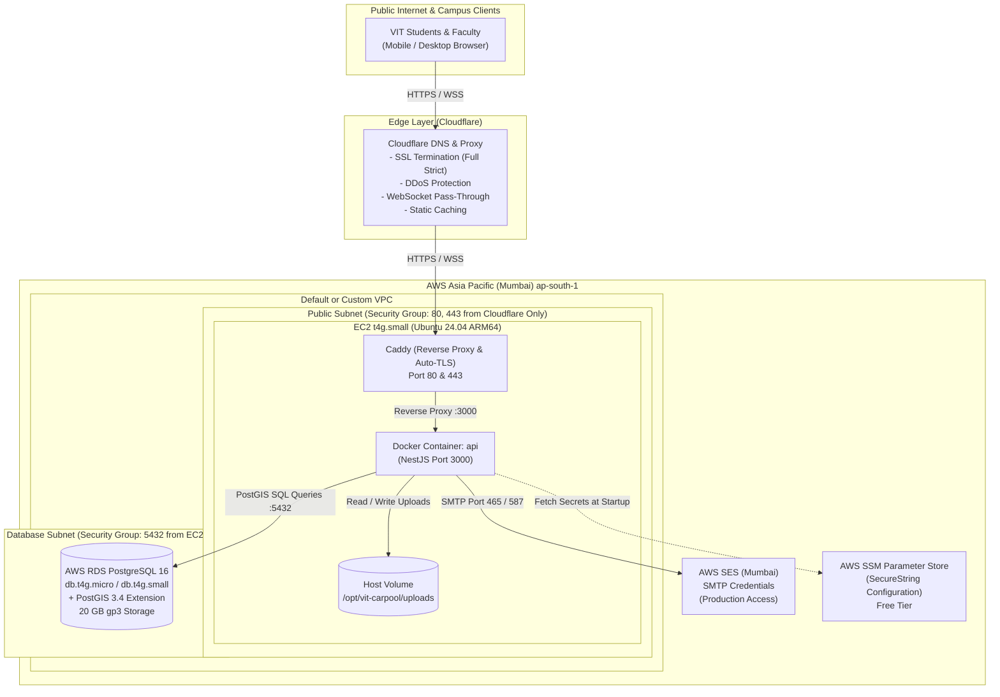

# AWS Production Deployment Architecture Validation Report
**Target Platform:** VIT Carpool (Exclusive Campus Carpooling for VIT Chennai)  
**Target Region:** AWS Asia Pacific (Mumbai) — `ap-south-1`  
**Expected Workload:** 20–50 Concurrent Users (Initial Launch Phase)  
**Report Date:** November 4, 2026  
**Status:** Comprehensive Source Code & Architectural Validation  

---

## Executive Summary

This report provides an independent, source-code-verified validation of the proposed AWS production deployment architecture for the **VIT Carpool** platform:
- **Compute:** AWS EC2 `t4g.small` (2 vCPU, 2 GB RAM, ARM64 Graviton2)
- **Database:** AWS RDS PostgreSQL 16 with PostGIS extension (`db.t4g.micro` / `db.t4g.small`)
- **Storage:** AWS S3 for document & image storage
- **Email:** AWS SES for OTP delivery
- **Networking & Ingress:** Cloudflare DNS + Caddy (Reverse Proxy & Auto-TLS)
- **Deployment Mechanics:** Docker Compose + GitHub Actions CI/CD + AWS SSM Parameter Store

Every recommendation in this document is derived directly from the application codebase (`apps/api`, `apps/web`, `packages/contracts`, `packages/db`, and Prisma migration scripts) rather than general assumptions.

---

## Architecture Component Validation Matrix

| Component | Proposed Tech | Actual Implementation in Code | Classification | Primary Action Required |
| :--- | :--- | :--- | :--- | :--- |
| **Email Service** | AWS SES | `nodemailer` with SMTP configuration (`SMTP_HOST`, `SMTP_PORT`, `SMTP_USER`, `SMTP_PASS`) | **NEEDS CHANGE** | Use AWS SES **SMTP Interface** credentials (no SES SDK needed). Must request **SES Production Access** to exit SES Sandbox. |
| **Document & Photo Storage** | AWS S3 | `UploadsService` writing directly to local disk (`uploads/avatars`, `uploads/vehicles`) via Multer buffer | **BLOCKER** *(for stateless S3)* / **NEEDS CHANGE** | Code currently lacks S3 driver. Must either mount persistent Docker host volume (`- ./uploads:/app/apps/api/uploads`) OR write S3 upload adapter with `@aws-sdk/client-s3`. |
| **Database & Spatial Engine** | AWS RDS PostgreSQL with PostGIS | Prisma schema with `postgresqlExtensions` (`postgis`, `uuid-ossp`), GiST indexes, `ST_DWithin` queries | **READY** *(with config caveat)* | RDS PostgreSQL supports PostGIS natively. Migrations must be run with `rds_superuser` privileges to execute `CREATE EXTENSION postgis`. |
| **Real-Time Tracking & WebSockets** | WebSocket / Caddy | Socket.io (`/tracking` namespace, `/socket.io` path) with `websocket` and `polling` fallback | **READY** | Caddy natively handles WebSocket proxying. Cloudflare 100s idle timeout is handled by Socket.io 25s heartbeat. |
| **Proxy & Client IP Resolution** | Cloudflare + Caddy | Express in-memory IP rate-limiters (`AuthRateLimiterGuard`, `LocationRateLimiterGuard`) | **BLOCKER** *(if unconfigured)* | Express `trust proxy` must be configured via `TRUST_PROXY` env; Caddy must forward `X-Forwarded-For` and `CF-Connecting-IP`, otherwise entire campus shares one IP and gets rate-limited. |
| **Background Jobs** | In-app cron / scheduler | In-process `setInterval` with `timer.unref()` (`OtpCleanupService`, `RecurringCommuteScheduler`, `VerificationPurgeService`) | **READY** | Runs entirely in-process within Node.js. No Redis/SQS required for single instance. |
| **Admin Setup & MFA** | Super-admin access | Server-side CLI bootstrap script (`packages/db/scripts/bootstrap-super-admin.ts`) + custom HMAC OTP | **READY** | Must be executed via `docker compose exec api ...` after target administrator registers their initial account. |
| **Containerization** | Docker Compose | Only `docker/postgres/Dockerfile` exists. No Dockerfiles for `apps/api` or `apps/web`. | **BLOCKER** | Production multi-stage `Dockerfile` for `apps/api` must be authored before EC2 Docker Compose deployment can function. |
| **Compute & Memory (EC2)** | `t4g.small` (2 GB RAM) | NestJS API (~250 MB) + Caddy (~40 MB) + OS (~350 MB) = ~700 MB runtime | **READY** *(Runtime)* / **BLOCKER** *(if building on instance)* | Sufficient for runtime (20–50 users). **Do not run `pnpm build` on EC2** (requires 1.5 GB peak; triggers OOM). Build images in GitHub Actions. |
| **Database Instance (RDS)** | `db.t4g.micro` (1 GB RAM) | PostgreSQL 16 + PostGIS extension + Prisma Client pool | **NEEDS CHANGE** / **COST RISK** | 1 GB RAM is tight for PostgreSQL + PostGIS (OS reserves ~350 MB). Viable for initial testing, but `db.t4g.small` (2 GB RAM) is strongly advised for stability. |
| **Secrets Management** | SSM Parameter Store | Environment variables validated via Zod schema (`apps/api/src/config/env.validation.ts`) | **READY** *(Cost-Effective)* | Standard SSM Parameter Store (SecureString) is free and avoids the $0.40/secret/mo cost of AWS Secrets Manager. |

---

## Detailed Technical Invariant Inspections

### 1. Authentication & Email Provider (AWS SES vs. Nodemailer)
* **Code Implementation:**
  - Authenticated via custom RS256 asymmetric JWT keypairs (`apps/api/src/modules/auth/auth.service.ts`), signed with private RSA key and verified with public key.
  - Email dispatching is handled in `apps/api/src/modules/auth/email.service.ts` using `nodemailer.createTransport()`.
  - The configuration strictly expects:
    ```
    SMTP_HOST (e.g. email-smtp.ap-south-1.amazonaws.com)
    SMTP_PORT (465 with SSL or 587 with STARTTLS)
    SMTP_SECURE (true for 465, false for 587)
    SMTP_USER (AWS SES SMTP Username, NOT IAM Access Key)
    SMTP_PASS (AWS SES SMTP Password, NOT IAM Secret Key)
    SMTP_FROM (e.g. "VIT Carpool <no-reply@vitcarpool.app>")
    ```
* **Operational Blockers & Traps:**
  > [!WARNING] **AWS SES Sandbox Mode:**  
  > All new AWS accounts in `ap-south-1` (Mumbai) have SES in **Sandbox Mode**. In Sandbox mode, emails can **ONLY** be sent to pre-verified email addresses. Sending OTPs to arbitrary `@vitstudent.ac.in` and `@vit.ac.in` email addresses will fail with `MessageRejected: Email address is not verified`.
  > **Remediation:** You must submit an SES Production Access Request in the AWS Console (detailing use case, bounce/complaint handling, and transaction type) at least 48 hours before launch.
* **AWS SES SDK:** The code does not use `@aws-sdk/client-ses`. It uses SMTP. Create an **SES SMTP Credential** set in the AWS SES Console.

---

### 2. Prisma Schema & RDS PostgreSQL Compatibility
* **Extensions & Schema Invariants:**
  - `packages/db/prisma/schema.prisma` declares:
    ```prisma
    datasource db {
      provider          = "postgresql"
      url               = env("DATABASE_URL")
      shadowDatabaseUrl = env("SHADOW_DATABASE_URL")
      extensions        = [postgis, uuidOssp(map: "uuid-ossp")]
    }
    ```
  - In RDS PostgreSQL, running `CREATE EXTENSION postgis;` and `CREATE EXTENSION "uuid-ossp";` requires the `rds_superuser` role.
* **Migration Strategy:**
  - When running `prisma migrate deploy` in production CI/CD, the connecting `DATABASE_URL` user must have administrative privileges or the database must be provisioned initially with PostGIS pre-installed.
  - In RDS, `SHADOW_DATABASE_URL` is **not used** during `prisma migrate deploy` (only during development `migrate dev`).
  - Connection strings must specify `?sslmode=require` or `?sslmode=verify-full`.

---

### 3. PostGIS Spatial Queries & Spatial Indexing
* **Actual Spatial Usage in Code:**
  - **Table:** `rides` has `origin_geom` and `destination_geom` of type `geography(Point, 4326)`.
  - **Triggers:** A native PostgreSQL trigger `sync_ride_geom()` automatically converts `origin_latitude`, `origin_longitude`, `destination_latitude`, and `destination_longitude` into geography points on INSERT/UPDATE:
    ```sql
    NEW.origin_geom := ST_SetSRID(ST_MakePoint(NEW.origin_longitude, NEW.origin_latitude), 4326)::geography;
    ```
  - **Indexes:** GiST spatial indexes exist:
    ```sql
    CREATE INDEX "rides_origin_geom_idx" ON "rides" USING GIST ("origin_geom");
    CREATE INDEX "rides_destination_geom_idx" ON "rides" USING GIST ("destination_geom");
    ```
  - **Queries:**
    - `apps/api/src/modules/rides/rides.service.ts`:
      ```sql
      ST_DWithin(r.origin_geom, ST_SetSRID(ST_MakePoint(${dto.originLon}, ${dto.originLat}), 4326)::geography, ${radiusMeters})
      ```
    - `apps/api/src/modules/ride-alerts/ride-alerts-matcher.service.ts`: Correlates subscriber alerts against new rides within corridor radius using `ST_DWithin`.
  - **Health Check:** `apps/api/src/modules/health/health.service.ts` executes `SELECT postgis_full_version();` and marks system health as `degraded` if PostGIS is missing.
* **RDS PostGIS Compatibility:**
  - RDS PostgreSQL 16 supports PostGIS 3.4.
  - Spatial queries will perform exceptionally well (sub-millisecond) because all spatial filters use native GiST indexed `ST_DWithin` rather than slow table-scanning Haversine calculations.

---

### 4. WebSocket Implementation & Reverse Proxy Architecture
* **Implementation:**
  - Framework: NestJS WebSocket Gateway on top of `socket.io` (`apps/api/src/modules/tracking/tracking.gateway.ts`).
  - Namespace: `/tracking`
  - Transport: `websocket` with HTTP `polling` fallback.
  - Path: `/socket.io`
* **Caddy Reverse Proxy Configuration:**
  - Caddy automatically detects and forwards WebSocket upgrade headers (`Upgrade: websocket` and `Connection: Upgrade`).
  - A standard Caddyfile block:
    ```caddyfile
    api.vitcarpool.app {
        reverse_proxy api:3000
    }
    ```
    is fully sufficient to route both REST endpoints and `/socket.io` WebSockets.
* **Cloudflare Considerations:**
  - Cloudflare WebSockets are enabled by default on free/pro plans.
  - Cloudflare has a **100-second idle timeout** for WebSocket connections.
  - In `socket.io`, the default ping interval is 25 seconds (`pingInterval: 25000, pingTimeout: 20000`), which continuously keeps the connection active and prevents Cloudflare from dropping idle tracking sockets.

---

### 5. File Upload & Document Storage (Local Disk vs. S3)
* **Code Reality:**
  - `apps/api/src/modules/uploads/uploads.service.ts` is strictly a **local filesystem driver**:
    ```ts
    this.baseUploadDir = process.env.UPLOADS_DIR
      ? path.resolve(process.env.UPLOADS_DIR)
      : path.resolve(process.cwd(), 'uploads');
    ```
  - Files (avatars and vehicle photos) are saved to disk via `fs.promises.writeFile`.
  - Files are served via `apps/api/src/modules/uploads/uploads.controller.ts` with `res.sendFile()`.
  - Health checks in `admin.service.ts` verify `fs.existsSync(uploadsDir)`.
* **Discrepancy with Proposed S3 Architecture:**
  > [!IMPORTANT] **No S3 Integration in Codebase:**  
  > The repository currently has no `@aws-sdk/client-s3`, no bucket configuration, and no pre-signed URL logic.
  > If deployed to Docker on EC2 without modifications, **you must mount an EC2 persistent host directory into the container**:
  > ```yaml
  > volumes:
  >   - /opt/vit-carpool/uploads:/app/apps/api/uploads
  > ```
  > Attempting to use S3 without refactoring `UploadsService` will not work. S3 can be phased in later by creating an `S3UploadsService` implementing the existing method signatures (`saveImage`, `deleteImage`).

---

### 6. Scheduled Jobs & Background Tasks
* **Code Implementation:**
  - `OtpCleanupService`: Runs every 30 minutes (`OTP_CLEANUP_INTERVAL_MS`). Deletes expired and consumed OTP rows.
  - `RecurringCommuteScheduler`: Runs every 1 hour (`RECURRING_COMMUTE_INTERVAL_MS`). Materializes recurring commute rides 14 days in advance.
  - `VerificationPurgeService`: Runs every 24 hours (`VERIFICATION_PURGE_INTERVAL_MS`). Purges campus ID images older than 30 days (`VERIFICATION_DOCUMENT_RETENTION_DAYS`).
* **Evaluation:**
  - All tasks run in-process using standard Node.js `setInterval` with `timer.unref()`.
  - They execute simple batch SQL queries with index scans.
  - **Resource Impact:** < 1% CPU spike and negligible memory.
  - **Concurrency:** Because the architecture runs a single EC2 instance, there is no risk of duplicate scheduler execution. No external Redis/BullMQ queue is needed for 20–50 concurrent users.

---

### 7. Rate Limiting & Client IP Resolution (Cloudflare + Caddy + Express)
* **Code Implementation:**
  - `AuthRateLimiterGuard` limits authentication endpoints (`/auth/otp/send`, `/auth/otp/verify`, `/admin/auth/login`) to **10 requests per 60 seconds per IP** (`AUTH_RATE_LIMIT_LIMIT=10`, `AUTH_RATE_LIMIT_TTL=60`).
  - `LocationRateLimiterGuard` limits autocomplete to **30 requests per 60 seconds per IP**.
  - `apps/api/src/main.ts` configures Express `trust proxy`:
    ```ts
    const trustProxyEnv = process.env.TRUST_PROXY?.trim();
    if (trustProxyEnv) {
      app.getHttpAdapter().getInstance().set('trust proxy', trustProxyEnv === 'true' ? 1 : trustProxyEnv);
    }
    ```
* **Critical Operational Invariant:**
  > [!CAUTION] **The "All Campus Blocked" Proxy Trap:**  
  > In the proposed architecture, traffic flows:  
  > `Client Browser -> Cloudflare CDN -> Caddy Reverse Proxy -> NestJS Container`  
  > That represents **2 proxy hops**.
  > If `TRUST_PROXY` is left empty or set to `false`, Express evaluates every request's IP as `127.0.0.1` or Caddy's Docker internal IP (`172.18.0.x`).
  > Under this condition, **all users on the platform share a single IP counter**. After 10 total login attempts campus-wide, the entire platform will lock all users out with HTTP 429 (`Too Many Requests`).
  > **Fix:**
  > 1. Set `TRUST_PROXY="linklocal,uniquelocal,loopback"` or `TRUST_PROXY="true"`.
  > 2. Ensure Caddy passes `X-Forwarded-For {remote_host}` and Cloudflare's `CF-Connecting-IP`.

---

### 8. Admin Authentication & Super-Admin Bootstrap
* **Code Implementation:**
  - Admin login (`/admin/auth/login` and `/admin/auth/verify`) requires the account to already have `role = ADMIN` or `role = SUPER_ADMIN`.
  - Roles cannot be acquired through regular public registration.
  - The repository includes a dedicated bootstrap script: `packages/db/scripts/bootstrap-super-admin.ts`.
* **Production Bootstrap Procedure:**
  1. The prospective Super Administrator registers a standard student or faculty account through the web app.
  2. On the EC2 host, run:
     ```bash
     docker compose exec api pnpm --filter @vit-carpool/db bootstrap:super-admin \
       --email "admin.user@vitstudent.ac.in" \
       --reason "Initial Production Deployment Bootstrap"
     ```
  3. The script verifies that no Super Admin exists, updates the user's role to `SUPER_ADMIN` in a database transaction, and logs a tamper-evident audit record in `audit_logs`.
  4. Subsequent admins are invited directly through the Admin Control Centre UI.

---

### 9. Containerization & pnpm Monorepo Build Requirements
* **Code Reality:**
  - Currently, **there is NO Dockerfile for `apps/api`** in the repository.
  - There is only `docker/postgres/Dockerfile`.
* **Build Requirements for `apps/api`:**
  A production Dockerfile for this pnpm 12 monorepo must be structured as a multi-stage build:
  1. **Base stage:** `node:22-bookworm-slim`, install `pnpm@12.15.0`.
  2. **Dependencies stage:** Copy `pnpm-workspace.yaml`, `pnpm-lock.yaml`, root and workspace `package.json` files, run `pnpm install --frozen-lockfile`.
  3. **Build stage:**
     - Run `pnpm --filter @vit-carpool/contracts build` (generates `packages/contracts/dist`).
     - Run `pnpm --filter @vit-carpool/db build` (runs `prisma generate` and `tsc`).
     - Run `pnpm --filter @vit-carpool/api build` (compiles NestJS to `apps/api/dist`).
  4. **Production runner stage:**
     - Copy production node_modules (`pnpm prune --prod`).
     - Copy built `dist` folders.
     - Set `USER node`.
     - Expose port `3000`.

---

### 10. Native Dependencies & ARM64 Graviton Compatibility
* **Dependency Audit:**
  - All core dependencies are pure JavaScript/TypeScript:
    - `@nestjs/*`, `class-validator`, `class-transformer`, `zod`
    - `jsonwebtoken`, `nodemailer`, `socket.io`, `web-push`
    - `multer` (in-memory buffer storage)
  - No C++ binary addons (`node-gyp`, `bcrypt`, `sharp`, `better-sqlite3`, or `canvas`).
  - Passwords and verification codes use native Node.js `crypto` (`crypto.createHmac`, `crypto.randomInt`).
* **Prisma Engine Compatibility:**
  - `@prisma/client` and `prisma: "^5.22.0"` support native `linux-arm64-openssl-3.0.x`.
  - When compiled in an ARM64 container on Graviton (`t4g.small`), Prisma automatically downloads and links the correct binary.
  - **Verdict:** **100% ARM64 / AWS Graviton compatible.**

---

## Sizing Feasibility: 20–50 Concurrent Users

### 1. EC2 `t4g.small` (2 vCPU, 2 GB RAM — ~$14.50/mo in Mumbai)
* **Runtime Memory Breakdown:**
  - Linux Kernel & Systemd OS: ~250 MB
  - Docker Daemon & Container Overhead: ~100 MB
  - Caddy Web Server: ~35 MB
  - NestJS API Process (`node dist/src/main.js`): ~200 MB idle; ~350 MB under 50 active socket/HTTP users.
  - **Total Projected Usage:** **~735 MB – 850 MB** out of **2,048 MB**.
* **Headroom:** ~1,200 MB free memory (over 55% buffer).
* **CPU Credits & Burstable Profile:**
  - `t4g.small` has a baseline of 20% CPU utilization across 2 vCPUs and accumulates 24 CPU credits/hour.
  - For 20–50 users browsing rides, booking seats, and sending coordinates every 3–5 seconds, CPU utilization will average between 3% and 7%.
  - It will continuously run in credit surplus.
* **CRITICAL BUILD CONSTRAINT:**
  > [!WARNING] **Do NOT build containers on the `t4g.small` instance:**  
  > Running `tsc` or `pnpm install` on a 2 GB EC2 instance will consume >1.5 GB memory and trigger the Linux Out-Of-Memory (OOM) killer, freezing the server.
  > Images MUST be built in GitHub Actions (or local machine) and pulled from a container registry (e.g. GitHub Container Registry `ghcr.io` or Amazon ECR).
  > Configure a **2 GB Swap File** on the EC2 EBS volume as an insurance policy.

---

### 2. RDS PostgreSQL `db.t4g.micro` vs. `db.t4g.small`
* **`db.t4g.micro` (2 vCPU, 1 GB RAM — ~$14.00/mo in Mumbai, or Free Tier eligible):**
  - **Memory Reality:** AWS RDS reserves ~350 MB for the operating system and RDS management agents. This leaves only **~650 MB** for PostgreSQL.
  - PostGIS extensions pre-load spatial libraries (GEOS, Proj, GDAL) into memory.
  - Prisma client connection pool defaults to `num_cpus * 2 + 1` = 5 to 10 connections.
  - Each PostgreSQL backend process consumes 5–10 MB of RAM.
  - **Verdict on `db.t4g.micro`:** It **will work** for 20–50 users *if* connection limits are strictly bounded (`DATABASE_URL=...?connection_limit=10`) and long-lived transactions are avoided. However, memory headroom is slim (~200 MB).
* **Recommendation:**
  - For beta testing: `db.t4g.micro` is acceptable.
  - For official campus launch: Upgrade to **`db.t4g.small`** (2 vCPU, 2 GB RAM — ~$28.00/mo in Mumbai). The additional 1 GB of memory provides comfortable buffer for PostGIS spatial indexes and query caching.

---

## Unexpected AWS Charges & Cost Optimization Traps

| Cost Trap | Typical Monthly Surprise | Why It Happens | Prevention Strategy |
| :--- | :--- | :--- | :--- |
| **AWS Public IPv4 Address** | **$3.65 / month** ($0.005/hr) | Effective Feb 2024, AWS charges for every public IPv4 address assigned to EC2. | Unavoidable if EC2 is directly public. Factor $3.65/mo into your budget. |
| **AWS Secrets Manager** | **$8.00 – $15.00 / month** ($0.40 / secret / mo + API calls) | Many developers store 20 individual keys in Secrets Manager. | **Use AWS SSM Parameter Store (Standard)** instead. Standard parameters are **$0.00 (100% Free)**. |
| **NAT Gateway** | **$32.00 – $38.00 / month** ($0.045/hr + $0.045/GB) | Created when placing EC2 in private subnets without understanding the cost. | **Do NOT create a NAT Gateway**. Place the single EC2 instance in a public subnet with a strict Security Group (only ports 80/443 open to Cloudflare IPs, SSH via SSM Session Manager). |
| **RDS Multi-AZ Deployment** | **Doubles RDS cost** (+$14 to +$28/mo) | Enabling Multi-AZ accidentally during RDS wizard creation. | Select **Single-AZ deployment**. For 20–50 concurrent users, automated daily snapshots (7-day retention) provide sufficient disaster recovery without 2x cost. |
| **RDS Storage Autoscaling Runaway** | Variable ($5 – $50/mo) | RDS default storage autoscaling can scale disk up to 1,000 GB without warning. | Set allocated storage to **20 GB gp3** and set **Maximum Storage Threshold to 50 GB**. |
| **SES Out-of-Region Data Transfer** | $0.09 / GB | Sending emails via SES in `us-east-1` from EC2 in `ap-south-1`. | Keep SES in **`ap-south-1` (Mumbai)**. Same-region transfer is free, and the first 62,000 emails/mo from EC2 are free. |

---

## Recommended Deployment Topology & Architecture



---

## Actionable Pre-Deployment Checklist

Before provisioning AWS resources or executing production migrations, complete the following items:

1. **Submit SES Production Access Request:**
   - In AWS SES Mumbai (`ap-south-1`), submit an access request specifying transactional carpool verification OTPs.
   - Verify your sending domain (e.g., `vitcarpool.app`) with DKIM and SPF records in Cloudflare DNS.
   - Generate an **SES SMTP credential pair** (copy the SMTP username and password).
2. **Author Production `Dockerfile` for `apps/api`:**
   - Create `apps/api/Dockerfile` using multi-stage build (`pnpm fetch`, build contracts, build db/prisma, build api).
   - Configure a GitHub Actions workflow to build the ARM64 image using `docker/setup-buildx-action` and push to GitHub Container Registry (`ghcr.io`).
3. **Configure Frontend Hosting Strategy:**
   - *Option A (Recommended):* Deploy `apps/web` on **Vercel** (Free, zero EC2 resource usage, edge CDN, seamless updates via `pnpm run build`).
   - *Option B:* Build `apps/web` into static assets and serve directly through Caddy on the EC2 instance.
4. **Provision AWS SSM Parameters:**
   - Store production secrets in AWS Systems Manager Parameter Store under path `/vit-carpool/prod/`:
     - `DATABASE_URL` (pointing to RDS endpoint with `sslmode=require`)
     - `JWT_PRIVATE_KEY` and `JWT_PUBLIC_KEY` (2048-bit RSA PEM pair)
     - `OTP_HMAC_SECRET` (random 32+ character hex string)
     - `SMTP_USER`, `SMTP_PASS`, `SMTP_HOST`, `SMTP_PORT`
     - `MAPBOX_ACCESS_TOKEN` (production token; required by `env.validation.ts`)
     - `TRUST_PROXY="true"`
5. **RDS PostgreSQL Initialization:**
   - Launch RDS PostgreSQL 16 (Single-AZ, `gp3` 20 GB, storage autoscaling max 50 GB).
   - Connect using master credentials and execute:
     ```sql
     CREATE EXTENSION IF NOT EXISTS "uuid-ossp";
     CREATE EXTENSION IF NOT EXISTS "postgis";
     ```
   - Run `pnpm --filter @vit-carpool/db prisma migrate deploy`.
6. **Bootstrap Super Administrator:**
   - Have the primary administrator sign up with their official VIT email address.
   - SSH into EC2 (via AWS SSM Session Manager) and execute `bootstrap:super-admin`.

