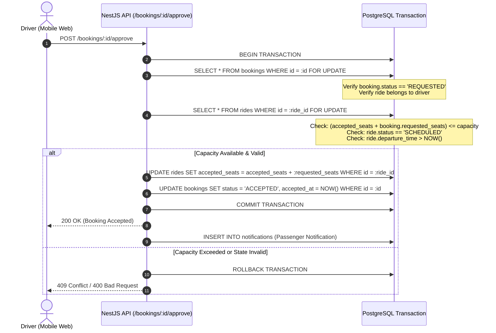

# System Architecture Specification

## 1. Executive Summary & Design Principles

The VIT Chennai Carpooling Platform is engineered as a **mobile-first, single-codebase modular monolith** optimized for a solo developer. It delivers maximum reliability, clear domain separation, rock-solid security invariants, and low operational overhead.

### Architectural Tenets
1. **The Backend is the Single Source of Truth**: The NestJS API is the sole gatekeeper for all business logic, database mutations, and external integrations. The client browser has zero direct access to Supabase database tables or server secrets.
2. **Database-Level Integrity**: Critical invariants (such as audience isolation and seat capacity limits) are enforced by PostgreSQL constraints, composite foreign keys, and transactions, not just application code.
3. **Decoupled Geospatial Processing**: External routing and map APIs are expensive and rate-limited. Geographic candidate filtering is executed inside PostGIS using spatial indexes before any external routing engine is consulted.
4. **Lean Infrastructure**: A single PostgreSQL instance provides relational storage, PostGIS spatial calculations, and persistent asynchronous job queuing via `pg-boss`. No separate Redis cluster is required for the initial MVP.
5. **Progressive Web App (PWA) First**: The web frontend is engineered for responsive mobile screens, installable as a standalone PWA on iOS and Android devices, without requiring separate native codebases or Capacitor wrappers.

---

## 2. High-Level System Architecture

```mermaid
flowchart TD
    subgraph Client["Client Tier (Mobile & Desktop)"]
        Browser["Mobile/Desktop Browser (PWA)"]
        ViteApp["React 19 + TypeScript + Vite + TanStack Query"]
        SW["Service Worker & PWA Manifest"]
        Browser --> ViteApp
        ViteApp --> SW
    end

    subgraph AuthProvider["External Auth Tier"]
        SupaAuth["Supabase Auth (Institutional Email / OTP)"]
    end

    subgraph APITier["Backend API Tier (Modular Monolith)"]
        NestApp["NestJS Core API Engine"]
        AuthModule["Auth & User Module (JWT Guard)"]
        RidesModule["Rides & Vehicles Module"]
        BookingsModule["Bookings & Concurrency Module"]
        AlertsModule["Ride Alerts & Matching Engine"]
        GeoModule["Geospatial & Map Service"]
        NotificationsModule["Notifications Module"]
        
        NestApp --> AuthModule
        NestApp --> RidesModule
        NestApp --> BookingsModule
        NestApp --> AlertsModule
        NestApp --> GeoModule
        NestApp --> NotificationsModule
    end

    subgraph AsyncTier["Background Job Processing"]
        PgBoss["pg-boss Job Runner (In-Process / Worker)"]
        AlertJob["Ride Alert Matcher"]
        MaterializeJob["Recurring Ride Materializer"]
        NotifyJob["Notification Dispatcher"]
        ExpireJob["Stale Booking & Alert Expiry"]
        
        PgBoss --> AlertJob
        PgBoss --> MaterializeJob
        PgBoss --> NotifyJob
        PgBoss --> ExpireJob
    end

    subgraph StorageTier["Data & Spatial Tier"]
        Postgres[("PostgreSQL 16 + PostGIS 3.4")]
        PrismaORM["Prisma Client (Entity CRUD)"]
        RawSQL["Raw SQL Migrations (PostGIS, Triggers, Constraints)"]
    end

    subgraph GeoServices["External Geospatial Tier"]
        TileServer["Vector / Raster Map Tiles (OSM / MapTiler / CARTO)"]
        Router["Routing Engine (OSRM / Valhalla)"]
    end

    %% Interactions
    ViteApp -- "1. Login (Email OTP)" --> SupaAuth
    SupaAuth -- "2. Issue JWT" --> ViteApp
    ViteApp -- "3. REST API Requests (Bearer JWT)" --> NestApp
    AuthModule -- "Verify Token & Load Verified User" --> Postgres
    NestApp --> PrismaORM
    PrismaORM --> Postgres
    RawSQL -.-> Postgres
    PgBoss <--> Postgres
    GeoModule --> Router
    ViteApp -.-> TileServer
```



---

## 3. Technology Stack & Component Details

### 3.1 Frontend (`apps/web`)
* **Framework**: React 19 + Vite + TypeScript.
* **State Management**: **TanStack Query (v5)** for server state, optimistic updates, and automatic cache invalidation; minimal local UI state using React hooks.
* **Styling**: Vanilla CSS with a centralized design token system (CSS custom properties) supporting dark/light mode, high-contrast inputs, fluid typography, and mobile touch targets (>= 48px). No bulky CSS frameworks.
* **PWA Capabilities**: Web App Manifest (`manifest.webmanifest`), offline fallback service worker via `vite-plugin-pwa`, app icon sets, standalone display mode.
* **Forms & Validation**: React Hook Form with Zod schema validation matching API DTOs.
* **Mapping**: `maplibre-gl` for rendering vector/raster map layers, origin/destination pins, and route polylines.

### 3.2 Backend (`apps/api`)
* **Framework**: NestJS (v10+) with fastify or express adapter.
* **Architecture**: Modular Monolith organized by domain (`auth`, `users`, `vehicles`, `rides`, `bookings`, `alerts`, `notifications`, `geo`).
* **API Style**: RESTful with OpenAPI (Swagger) documentation automatically generated at `/api/docs`.
* **Security Middleware**:
  * `Helmet` for HTTP security headers.
  * CORS restricted strictly to approved origin domains.
  * Global `ValidationPipe` with `{ whitelist: true, forbidNonWhitelisted: true, transform: true }`.
  * `SupabaseAuthGuard` for cryptographic JWT verification.
  * `VerifiedUserGuard` to ensure the user has completed institutional verification.
  * `AudienceGuard` to prevent cross-audience endpoint invocation.
* **Logging**: Structured JSON logging with request correlation IDs (`pino` / `nestjs-pino`).

### 3.3 Database & Spatial Layer (`packages/db`)
* **Engine**: PostgreSQL 16+ with PostGIS 3.4+ extension enabled (`CREATE EXTENSION IF NOT EXISTS postgis;`).
* **ORM & Migrations**:
  * **Prisma**: Used for application entity definitions, TypeScript client generation, relation queries, and primary database schema baseline.
  * **Raw SQL Migrations**: Used for custom PostGIS spatial geometry columns (`GEOMETRY(Point, 4326)`, `GEOMETRY(LineString, 4326)`), spatial GIST indexes, triggers for composite audience integrity, and concurrency check constraints that Prisma cannot express natively.
* **Audience Enforcement**: Multi-column composite foreign keys:
  * `users (id, audience)` has a composite unique constraint.
  * `rides (id, audience)` has a composite unique constraint referencing `users (driver_id, audience)`.
  * `bookings` has composite foreign keys referencing `rides (ride_id, audience)` and `users (passenger_id, audience)`.

### 3.4 Background Jobs (`pg-boss`)
* **Engine**: `pg-boss` (lightweight job queue leveraging PostgreSQL `SKIP LOCKED` row concurrency).
* **Benefits**: Zero extra infrastructure (no Redis server, no additional hosting bill), ACID transaction coordination with the main database, durable persistence, automatic retries with exponential backoff.
* **Core Job Types**:
  1. `materialize-recurring-rides`: Runs nightly to project recurring templates into single ride instances up to 14 days ahead.
  2. `match-ride-alerts`: Triggered immediately upon new ride publication to find compatible passenger alerts.
  3. `expire-stale-bookings`: Runs every 5 minutes to auto-reject unapproved requests whose rides depart within 30 minutes.
  4. `send-notification-channel`: Dispatches external notifications (e.g. Email via Resend/Postmark) asynchronously without blocking HTTP request threads.

### 3.5 Geospatial & Routing Abstraction
* **Interface**: A dedicated `GeoService` interface decouples the application from any specific vendor:
  ```typescript
  export interface IGeoService {
    geocode(query: string): Promise<GeocodingResult[]>;
    reverseGeocode(lat: number, lon: number): Promise<AddressResult>;
    calculateRoute(origin: Coordinates, destination: Coordinates): Promise<RouteSummary>;
  }
  ```
* **Database Spatial Filtering**:
  * Searches compute candidate rides using `ST_DWithin` on indexed spatial points (`Point, 4326` cast to `geography`) for pickup and drop-off tolerances (default: 1.5 km).
  * Route direction sanity is verified using `ST_LineLocatePoint` on the ride trajectory to ensure pickup location comes *before* destination location along the travel path.
* **External Providers**: MapLibre for UI display, OpenStreetMap / Carto for tiles, and Valhalla / OSRM (or free-tier provider) for driving distance and polyline calculation.

---

## 4. Repository & Monorepo Structure

The project utilizes a `pnpm` workspace structure:

```
vit-carpool/
├── .github/                  # CI/CD workflows (lint, test, build)
├── apps/
│   ├── api/                  # NestJS modular monolith API
│   │   ├── src/
│   │   │   ├── modules/      # Domain modules (auth, rides, bookings, etc.)
│   │   │   ├── common/       # Guards, filters, interceptors, decorators
│   │   │   └── config/       # Environment schema and configuration
│   │   └── test/             # Integration and e2e test suites
│   └── web/                  # Vite + React 19 PWA
│       ├── public/           # Static assets, PWA icons, manifest
│       └── src/
│           ├── components/   # Accessible, reusable UI components
│           ├── features/     # Feature-driven UI slices (rides, bookings)
│           ├── hooks/        # React Query hooks and custom utilities
│           └── styles/       # Vanilla CSS design tokens & utilities
├── packages/
│   ├── contracts/            # Shared TypeScript DTOs, Zod schemas, API types
│   └── db/                   # Prisma schema, SQL migrations, seed scripts
├── docs/                     # Architecture, security, database, and plans
├── docker-compose.yml        # Local PostgreSQL + PostGIS container definition
├── package.json              # Monorepo root package.json
├── pnpm-workspace.yaml       # pnpm workspace definition
├── tsconfig.base.json        # Shared TypeScript configuration
└── README.md                 # Primary project documentation
```

---

## 5. Security & Authentication Architecture

1. **Authentication Handshake**:
   * User signs in via Supabase Auth in the frontend using their institutional email.
   * Supabase validates the institutional email (via OTP or magic link) and returns a signed JWT containing `sub` (auth UUID) and `email`.
2. **NestJS JWT Interception**:
   * API receives `Authorization: Bearer <jwt>`.
   * `SupabaseAuthGuard` cryptographically verifies the JWT signature against Supabase’s public JSON Web Key Set (JWKS). The client runtime and any client-supplied headers are never trusted for identity.
3. **Database Identity Synchronization & Fail-Safe Audience Classification**:
   * The backend looks up the user record in PostgreSQL by `auth_user_id`.
   * **Mandatory Server-Side Email Normalization**: All server-side write paths (initial login synchronization, webhook handling, email-change reconciliation, verification requests) must normalize email inputs via `email.trim().toLowerCase()` before executing any query or database mutation. The database enforces this via `CHECK (email = LOWER(email))`.
   * **Zero Client Selection**: The client UI never provides an audience dropdown, and the API rejects any client payload attempting to specify or modify an `audience`, `role`, or `verification_status`.
   * **Observed Campus Email Examples**:
     * Student example: `rayavarapu.rohan2023@vitstudent.ac.in` (`@vitstudent.ac.in` domain, student name + joining year).
     * Faculty/Proctor example: `renukadevi.r@vit.ac.in` (`@vit.ac.in` domain, employee name format).
     * *Policy*: These are observed empirical examples, not yet confirmed universal rules. No domain pattern is hardcoded into application logic.
   * **Configurable Pattern Matching & Fail-Safe Engine**:
     * Matching patterns are configured strictly via environment variables:
       * `STUDENT_EMAIL_REGEX=^[a-zA-Z0-9._%+-]+@vitstudent\.ac\.in$`
       * `FACULTY_EMAIL_REGEX=^[a-zA-Z0-9._%+-]+@vit\.ac\.in$`
       * `ENABLE_AUTOMATIC_EMAIL_CLASSIFICATION=false` (**Disabled by default** until institutional patterns are officially confirmed).
     * **Classification Gate Conditions**: Matching a regex is **never** sufficient on its own. Automatic verification executes ONLY if:
       1. `ENABLE_AUTOMATIC_EMAIL_CLASSIFICATION` is explicitly set to `true`.
       2. The email identity is confirmed in Supabase Auth (`email_confirmed_at IS NOT NULL`).
       3. The email matches exactly **one** configured audience pattern with zero ambiguity.
     * **Classification Truth Table**:
       | `ENABLE_AUTO` | `email_confirmed` | Matches Student? | Matches Faculty? | Assigned `audience` | Assigned `status` | Method |
       | :--- | :--- | :--- | :--- | :--- | :--- | :--- |
       | `false` | Any | Any | Any | `NULL` | `PENDING` | `NULL` |
       | `true` | `false` | Any | Any | `NULL` | `PENDING` | `NULL` |
       | `true` | `true` | `true` | `false` | `STUDENT` | `VERIFIED` | `AUTOMATIC_EMAIL` |
       | `true` | `true` | `false` | `true` | `FACULTY` | `VERIFIED` | `AUTOMATIC_EMAIL` |
       | `true` | `true` | `true` | `true` | **`NULL` (Fail Safe)** | **`PENDING` (Fail Safe)** | **`NULL`** |
       | `true` | `true` | `false` | `false` | **`NULL` (Fail Safe)** | **`PENDING` (Fail Safe)** | **`NULL`** |
     * **Zero Admin Inference**: An email domain pattern **never** grants `ADMIN` role. Administrative privileges must be assigned manually in the database or via an administrative console.
4. **Audience Assignment vs. Account Status Separation**:
   * `audience` (`STUDENT`, `FACULTY`) represents verified campus community group membership.
   * `verification_status` (`PENDING`, `VERIFIED`, `REJECTED`, `SUSPENDED`) governs functional capability.
   * A suspended verified user retains their `STUDENT` or `FACULTY` audience in PostgreSQL (preventing foreign key cascading or broken historical ride references), but is strictly blocked from all protected carpooling features by API guards and database triggers.
5. **Trusted Server-Side Email-Change Handling & Concurrency Reconciliation**:
   * Client-provided email change notifications are **never** trusted or accepted by the API.
   * Email updates are detected exclusively through authoritative server-side channels:
     * **Primary Channel (Signed Webhooks)**: Supabase Auth emits an HTTP POST to `/auth/webhook` on `user.updated`. The API verifies the cryptographic HMAC signature (`x-supabase-signature`) using `SUPABASE_WEBHOOK_SECRET` before processing.
     * **In-Flight Dual Layer (`SupabaseAuthGuard`)**: On every authenticated API request, the guard inspects the verified JWT's `email` claim against `users.email` loaded from PostgreSQL. If a divergence is detected, the synchronization workflow triggers immediately.
   * **Sequence Tracking & Pessimistic Concurrency**:
     * The `users` table tracks `auth_updated_at` (the Supabase Auth event timestamp).
     * When processing an email change, the backend executes an atomic PostgreSQL transaction with row-level locking: `SELECT * FROM users WHERE auth_user_id = :sub FOR UPDATE`.
     * **Stale Event Rejection**: If `incoming.updated_at < users.auth_updated_at`, the event is dropped as stale (idempotent no-op). Stale events can never restore access or overwrite newer identity state.
     * **Duplicate Event Idempotency**: If `incoming.updated_at == users.auth_updated_at` and `incoming.email == users.email`, the handler returns `200 OK` without database mutation.
     * **Ambiguous Event Conflict Resolution**: If `incoming.updated_at == users.auth_updated_at` and `LOWER(incoming.email) != users.email`:
       * Timestamps alone do NOT prove which payload is authoritative.
       * The API performs a direct server-to-server fetch against the authoritative source of truth: `supabase.auth.admin.getUserById(auth_user_id)`.
       * If `authoritative.email != users.email`:
         1. Sets `email = LOWER(authoritative.email)`.
         2. Sets `auth_updated_at = authoritative.updated_at`.
         3. Sets `verification_status = 'PENDING'` and `verified_at = NULL`.
         4. Preserves existing `audience` and `verification_method`.
         5. Transactionally writes an audit record: `action = 'USER_EMAIL_RECONCILED'`.
       * If `authoritative.email == users.email`: The event is dropped as a spurious mismatch; returns `200 OK`.
     * **Transactional Revocation for Newer Events**: If `incoming.updated_at > users.auth_updated_at` and `LOWER(incoming.email) != users.email`:
       1. Sets `email = LOWER(incoming.email)`.
       2. Sets `auth_updated_at = incoming.updated_at`.
       3. Sets `verification_status = 'PENDING'` and `verified_at = NULL` (instantly revoking carpooling access).
       4. **Preserves existing `audience` and `verification_method`**: A user is **never** transferred between student and faculty groups merely by changing their email.
       5. Writes an immutable audit record to `audit_logs` capturing old email, new email, and status transition.
     * **Access Revocation Invariance**: Carpooling access remains strictly revoked throughout any ambiguous or updated state until institutional verification rules are satisfied.
     * Transient database errors return `500` to trigger Supabase Auth's exponential backoff webhook retry.
6. **Controlled Manual Verification Fallback & Document Retention Safeguards**:
   * Users in `PENDING` status cannot access carpooling features.
   * Unmatched users submit an institutional ID card image to the `/verification/request` endpoint.
   * **Private Storage & Access Expiration**: Documents are stored in a private Supabase Storage bucket (`id-documents`) with all public access disallowed. Authorized admins inspect documents via short-lived signed URLs (15-minute TTL).
   * **Automated 30-Day Purge & Retry Safeguards**:
     * The retention clock starts when a verification request reaches a terminal status (`APPROVED` or `REJECTED`).
     * A background worker permanently deletes the document file from storage after 30 days and sets `id_card_document_purged_at = NOW()`.
     * If storage deletion encounters a network or service error, the worker retries with exponential backoff (up to 5 attempts).
     * If unpurged after 35 days, a high-priority `STORAGE_PURGE_FAILURE` alert is emitted for administrator intervention.
     * Every successful document deletion records a permanent event in `audit_logs`.
7. **Transactional Audit Logging, Table Ownership & Role Permissions**:
   * All sensitive state changes (verifications, suspensions, role modifications, email mutations) are written transactionally in the same database transaction as the target change.
   * Actor identity and administrative roles are derived strictly from server-side session records.
   * `actor_id` in `audit_logs` is a standalone UUID column without cascading foreign keys (`ON DELETE SET NULL`), preventing trigger exceptions during privacy erasure while ensuring append-only immutability.
   * **Role Architecture & Table Ownership**:
     * Migration Role (`postgres` / `migrator`): Table owner; possesses DDL permissions to create tables and manage triggers.
     * Runtime Role (`app_user` / `service_role`): Non-owner; possesses least-privilege DML (`SELECT, INSERT, UPDATE` on domain tables, strictly append-only `SELECT, INSERT` on `audit_logs`). Direct `EXECUTE` grants on trigger functions are omitted. Schema creation is revoked (`REVOKE CREATE ON SCHEMA public FROM app_user`).
     * Because the runtime role is a non-owner and lacks schema creation privileges, it cannot alter tables, disable `trg_audit_log_immutable`, or create shadow objects.
     * Role bootstrap is strictly separated from schema migrations; credentials are supplied via environment variables (`DATABASE_APP_USER_PASSWORD`).
     * Integration tests verify permission enforcement using the actual runtime role connection (`UPDATE`, `DELETE`, `TRUNCATE`, `ALTER TABLE DISABLE TRIGGER`, `CREATE TABLE` must all fail).
8. **Access Control Gates**:
   * `VerifiedUserGuard`: Blocks non-`VERIFIED` users (`PENDING`, `REJECTED`, `SUSPENDED`) from carpooling endpoints (`/rides`, `/bookings`, `/alerts`).
   * `AudienceGuard`: Enforces that student tokens only touch student resources, and faculty tokens only touch faculty resources. Both application guards and database composite foreign keys enforce this isolation.

---

## 6. Concurrency Control & Booking Transaction

Booking approval must be atomic to prevent overbooking:



This ensures that concurrent requests from multiple drivers or rapid clicking cannot exceed the car's available seats.
