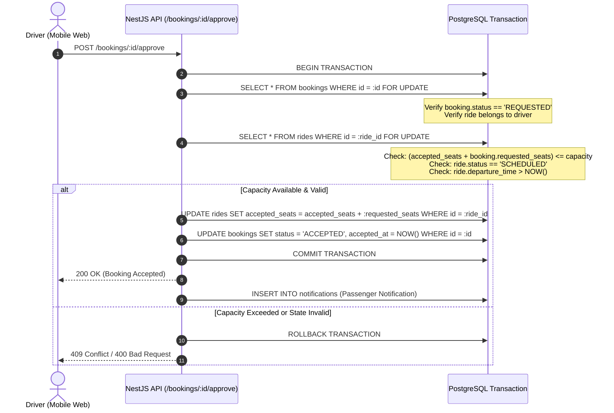

# System Architecture Specification

## 1. Executive Summary & Design Principles

The VIT Chennai Carpooling Platform is engineered as a **mobile-first, single-codebase modular monolith** optimized for a solo developer. It delivers maximum reliability, clear domain separation, rock-solid security invariants, and low operational overhead.

### Architectural Tenets
1. **The Backend is the Single Source of Truth**: The NestJS API is the sole gatekeeper for all business logic, database mutations, and external integrations. The client browser has zero direct access to Supabase database tables or server secrets.
2. **Database-Level Integrity**: Critical invariants (such as audience isolation and seat capacity limits) are enforced by PostgreSQL constraints, composite foreign keys, and transactions, not just application code.
3. **Decoupled Geospatial Processing**: External routing and map APIs are expensive and rate-limited. Geographic candidate filtering is executed inside PostGIS using spatial indexes before any external routing engine is consulted.
4. **Lean Infrastructure**: A single PostgreSQL instance provides relational storage, PostGIS spatial calculations, and persistent asynchronous job queuing via `pg-boss`. No separate Redis cluster is required for the initial MVP.
5. **Progressive Web App (PWA) First**: The web frontend is engineered for responsive mobile screens, installable as a standalone PWA on iOS and Android devices, without requiring separate native codebases or Capacitor wrappers.

---

## 2. High-Level System Architecture

```mermaid
flowchart TD
    subgraph Client["Client Tier (Mobile & Desktop)"]
        Browser["Mobile/Desktop Browser (PWA)"]
        ViteApp["React 19 + TypeScript + Vite + TanStack Query"]
        SW["Service Worker & PWA Manifest"]
        Browser --> ViteApp
        ViteApp --> SW
    end

    subgraph AuthProvider["External Auth Tier"]
        SupaAuth["Supabase Auth (Institutional Email / OTP)"]
    end

    subgraph APITier["Backend API Tier (Modular Monolith)"]
        NestApp["NestJS Core API Engine"]
        AuthModule["Auth & User Module (JWT Guard)"]
        RidesModule["Rides & Vehicles Module"]
        BookingsModule["Bookings & Concurrency Module"]
        AlertsModule["Ride Alerts & Matching Engine"]
        GeoModule["Geospatial & Map Service"]
        NotificationsModule["Notifications Module"]
        
        NestApp --> AuthModule
        NestApp --> RidesModule
        NestApp --> BookingsModule
        NestApp --> AlertsModule
        NestApp --> GeoModule
        NestApp --> NotificationsModule
    end

    subgraph AsyncTier["Background Job Processing"]
        PgBoss["pg-boss Job Runner (In-Process / Worker)"]
        AlertJob["Ride Alert Matcher"]
        MaterializeJob["Recurring Ride Materializer"]
        NotifyJob["Notification Dispatcher"]
        ExpireJob["Stale Booking & Alert Expiry"]
        
        PgBoss --> AlertJob
        PgBoss --> MaterializeJob
        PgBoss --> NotifyJob
        PgBoss --> ExpireJob
    end

    subgraph StorageTier["Data & Spatial Tier"]
        Postgres[("PostgreSQL 16 + PostGIS 3.4")]
        PrismaORM["Prisma Client (Entity CRUD)"]
        RawSQL["Raw SQL Migrations (PostGIS, Triggers, Constraints)"]
    end

    subgraph GeoServices["External Geospatial Tier"]
        TileServer["Vector / Raster Map Tiles (OSM / MapTiler / CARTO)"]
        Router["Routing Engine (OSRM / Valhalla)"]
    end

    %% Interactions
    ViteApp -- "1. Login (Email OTP)" --> SupaAuth
    SupaAuth -- "2. Issue JWT" --> ViteApp
    ViteApp -- "3. REST API Requests (Bearer JWT)" --> NestApp
    AuthModule -- "Verify Token & Load Verified User" --> Postgres
    NestApp --> PrismaORM
    PrismaORM --> Postgres
    RawSQL -.-> Postgres
    PgBoss <--> Postgres
    GeoModule --> Router
    ViteApp -.-> TileServer
```



---

## 3. Technology Stack & Component Details

### 3.1 Frontend (`apps/web`)
* **Framework**: React 19 + Vite + TypeScript.
* **State Management**: **TanStack Query (v5)** for server state, optimistic updates, and automatic cache invalidation; minimal local UI state using React hooks.
* **Styling**: Vanilla CSS with a centralized design token system (CSS custom properties) supporting dark/light mode, high-contrast inputs, fluid typography, and mobile touch targets (>= 48px). No bulky CSS frameworks.
* **PWA Capabilities**: Web App Manifest (`manifest.webmanifest`), offline fallback service worker via `vite-plugin-pwa`, app icon sets, standalone display mode.
* **Forms & Validation**: React Hook Form with Zod schema validation matching API DTOs.
* **Mapping**: `maplibre-gl` for rendering vector/raster map layers, origin/destination pins, and route polylines.

### 3.2 Backend (`apps/api`)
* **Framework**: NestJS (v10+) with fastify or express adapter.
* **Architecture**: Modular Monolith organized by domain (`auth`, `users`, `vehicles`, `rides`, `bookings`, `alerts`, `notifications`, `geo`).
* **API Style**: RESTful with OpenAPI (Swagger) documentation automatically generated at `/api/docs`.
* **Security Middleware**:
  * `Helmet` for HTTP security headers.
  * CORS restricted strictly to approved origin domains.
  * Global `ValidationPipe` with `{ whitelist: true, forbidNonWhitelisted: true, transform: true }`.
  * `SupabaseAuthGuard` for cryptographic JWT verification.
  * `VerifiedUserGuard` to ensure the user has completed institutional verification.
  * `AudienceGuard` to prevent cross-audience endpoint invocation.
* **Logging**: Structured JSON logging with request correlation IDs (`pino` / `nestjs-pino`).

### 3.3 Database & Spatial Layer (`packages/db`)
* **Engine**: PostgreSQL 16+ with PostGIS 3.4+ extension enabled (`CREATE EXTENSION IF NOT EXISTS postgis;`).
* **ORM & Migrations**:
  * **Prisma**: Used for application entity definitions, TypeScript client generation, relation queries, and primary database schema baseline.
  * **Raw SQL Migrations**: Used for custom PostGIS spatial geometry columns (`GEOMETRY(Point, 4326)`, `GEOMETRY(LineString, 4326)`), spatial GIST indexes, triggers for composite audience integrity, and concurrency check constraints that Prisma cannot express natively.
* **Audience Enforcement**: Multi-column composite foreign keys:
  * `users (id, audience)` has a composite unique constraint.
  * `rides (id, audience)` has a composite unique constraint referencing `users (driver_id, audience)`.
  * `bookings` has composite foreign keys referencing `rides (ride_id, audience)` and `users (passenger_id, audience)`.

### 3.4 Background Jobs (`pg-boss`)
* **Engine**: `pg-boss` (lightweight job queue leveraging PostgreSQL `SKIP LOCKED` row concurrency).
* **Benefits**: Zero extra infrastructure (no Redis server, no additional hosting bill), ACID transaction coordination with the main database, durable persistence, automatic retries with exponential backoff.
* **Core Job Types**:
  1. `materialize-recurring-rides`: Runs nightly to project recurring templates into single ride instances up to 14 days ahead.
  2. `match-ride-alerts`: Triggered immediately upon new ride publication to find compatible passenger alerts.
  3. `expire-stale-bookings`: Runs every 5 minutes to auto-reject unapproved requests whose rides depart within 30 minutes.
  4. `send-notification-channel`: Dispatches external notifications (e.g. Email via Resend/Postmark) asynchronously without blocking HTTP request threads.

### 3.5 Geospatial & Routing Abstraction
* **Interface**: A dedicated `GeoService` interface decouples the application from any specific vendor:
  ```typescript
  export interface IGeoService {
    geocode(query: string): Promise<GeocodingResult[]>;
    reverseGeocode(lat: number, lon: number): Promise<AddressResult>;
    calculateRoute(origin: Coordinates, destination: Coordinates): Promise<RouteSummary>;
  }
  ```
* **Database Spatial Filtering**:
  * Searches compute candidate rides using `ST_DWithin` on indexed spatial points (`Point, 4326` cast to `geography`) for pickup and drop-off tolerances (default: 1.5 km).
  * Route direction sanity is verified using `ST_LineLocatePoint` on the ride trajectory to ensure pickup location comes *before* destination location along the travel path.
* **External Providers**: MapLibre for UI display, OpenStreetMap / Carto for tiles, and Valhalla / OSRM (or free-tier provider) for driving distance and polyline calculation.

---

## 4. Repository & Monorepo Structure

The project utilizes a `pnpm` workspace structure:

```
vit-carpool/
├── .github/                  # CI/CD workflows (lint, test, build)
├── apps/
│   ├── api/                  # NestJS modular monolith API
│   │   ├── src/
│   │   │   ├── modules/      # Domain modules (auth, rides, bookings, etc.)
│   │   │   ├── common/       # Guards, filters, interceptors, decorators
│   │   │   └── config/       # Environment schema and configuration
│   │   └── test/             # Integration and e2e test suites
│   └── web/                  # Vite + React 19 PWA
│       ├── public/           # Static assets, PWA icons, manifest
│       └── src/
│           ├── components/   # Accessible, reusable UI components
│           ├── features/     # Feature-driven UI slices (rides, bookings)
│           ├── hooks/        # React Query hooks and custom utilities
│           └── styles/       # Vanilla CSS design tokens & utilities
├── packages/
│   ├── contracts/            # Shared TypeScript DTOs, Zod schemas, API types
│   └── db/                   # Prisma schema, SQL migrations, seed scripts
├── docs/                     # Architecture, security, database, and plans
├── docker-compose.yml        # Local PostgreSQL + PostGIS container definition
├── package.json              # Monorepo root package.json
├── pnpm-workspace.yaml       # pnpm workspace definition
├── tsconfig.base.json        # Shared TypeScript configuration
└── README.md                 # Primary project documentation
```

---

## 5. Security & Authentication Architecture

1. **Authentication Handshake**:
   * User signs in via Supabase Auth in the frontend using their institutional email.
   * Supabase validates the institutional email (via OTP or magic link) and returns a signed JWT containing `sub` (auth UUID) and `email`.
2. **NestJS JWT Interception**:
   * API receives `Authorization: Bearer <jwt>`.
   * `SupabaseAuthGuard` cryptographically verifies the JWT signature against Supabase’s public JSON Web Key Set (JWKS).
3. **Database Identity Synchronization & Configurable Audience Classification**:
   * The backend looks up the user record in PostgreSQL by `auth_user_id`.
   * **First-Time User Registration**:
     * The verified email is evaluated by the **Configurable Audience Classification Engine** using environment- or config-driven pattern matchers (`STUDENT_EMAIL_REGEX`, `FACULTY_EMAIL_REGEX`).
     * **Zero Client Selection**: The client UI never provides an audience dropdown, and the API rejects any client payload attempting to specify an audience.
     * If the email reliably matches an audience pattern, the user record is initialized as `VERIFIED` with the resolved `audience` (`STUDENT` or `FACULTY`).
     * If the email format cannot be classified automatically with certainty, the user record is initialized as `PENDING` with `audience = NULL`.
4. **Controlled Manual Verification Fallback**:
   * Users in `PENDING` status cannot access ride-sharing features.
   * The user may upload a campus ID card document to the `/verification/request` endpoint.
   * Authorized administrators review pending verification requests in an administrative queue, verify institutional affiliation, and assign the appropriate audience.
   * Every administrative decision writes an immutable record to `audit_logs` capturing reviewer ID, timestamp, and decision notes.
5. **Access Control Gates**:
   * `VerifiedUserGuard`: Blocks users who are not in `VERIFIED` status from accessing core endpoints (`/rides`, `/bookings`, `/alerts`).
   * `AudienceGuard`: Enforces that student tokens only touch student resources, and faculty tokens only touch faculty resources.

---

## 6. Concurrency Control & Booking Transaction

Booking approval must be atomic to prevent overbooking:



This ensures that concurrent requests from multiple drivers or rapid clicking cannot exceed the car's available seats.
