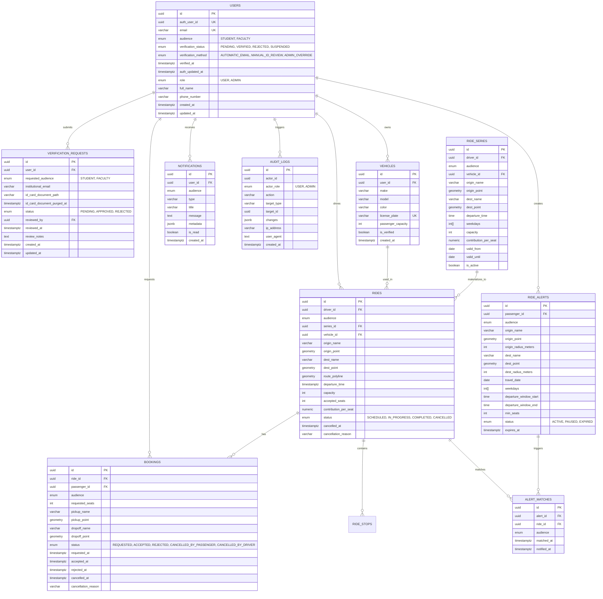
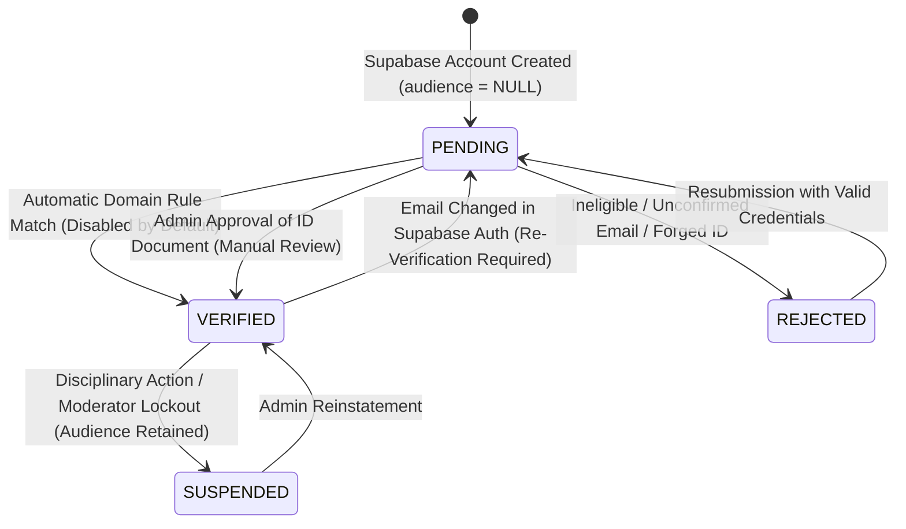
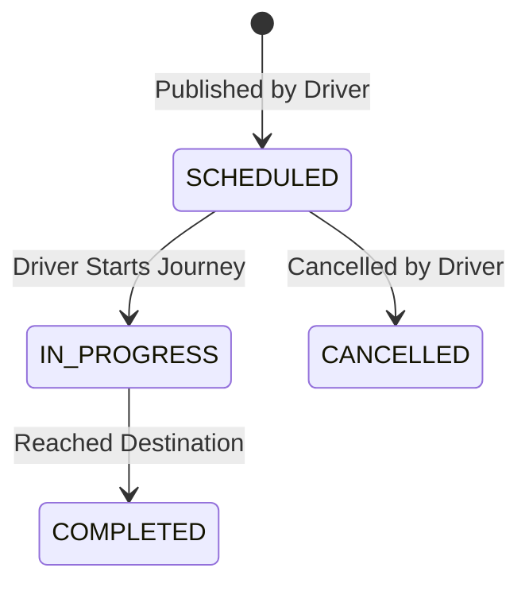
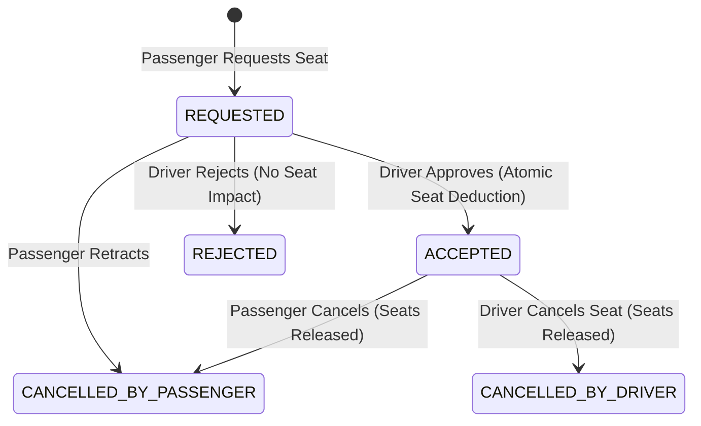

# Database Design & Schema Specification

## 1. Overview & Data Philosophy

The database design for the VIT Chennai Carpooling Platform uses PostgreSQL 16+ with the PostGIS 3.4+ extension. The primary design goal is **defense-in-depth**: critical business rules (such as audience isolation, capacity non-negativity, and booking state validity) must be guaranteed by the database schema itself, rather than relying exclusively on application-layer code.

---

## 2. Complete Entity Relationship Architecture



---

## 3. Database Schema Definitions & Constraints

### 3.1 Custom Types & Extensions
```sql
CREATE EXTENSION IF NOT EXISTS "uuid-ossp";
CREATE EXTENSION IF NOT EXISTS "postgis";

CREATE TYPE audience_type AS ENUM ('STUDENT', 'FACULTY');
CREATE TYPE verification_status_type AS ENUM ('PENDING', 'VERIFIED', 'REJECTED', 'SUSPENDED');
CREATE TYPE verification_method_type AS ENUM ('AUTOMATIC_EMAIL', 'MANUAL_ID_REVIEW', 'ADMIN_OVERRIDE');
CREATE TYPE user_role_type AS ENUM ('USER', 'ADMIN');
CREATE TYPE ride_status_type AS ENUM ('SCHEDULED', 'IN_PROGRESS', 'COMPLETED', 'CANCELLED');
CREATE TYPE booking_status_type AS ENUM (
    'REQUESTED',
    'ACCEPTED',
    'REJECTED',
    'CANCELLED_BY_PASSENGER',
    'CANCELLED_BY_DRIVER'
);
CREATE TYPE alert_status_type AS ENUM ('ACTIVE', 'PAUSED', 'EXPIRED');
CREATE TYPE verification_request_status_type AS ENUM ('PENDING', 'APPROVED', 'REJECTED');
```

---

### 3.2 Milestone 2 Identity Constraints & Audience Isolation

To guarantee security invariants directly at the database engine level, the following constraints are established:

```sql
-- 1. Permitted Verification State Combinations Check Constraint
-- Defines legal combinations of (verification_status, audience, verification_method, verified_at)
ALTER TABLE users ADD CONSTRAINT chk_users_verification_state CHECK (
    -- State 1: Active VERIFIED user (must have audience, method, and verified_at)
    (verification_status = 'VERIFIED' 
        AND audience IS NOT NULL 
        AND verification_method IS NOT NULL 
        AND verified_at IS NOT NULL)
    OR
    -- State 2: SUSPENDED user (retains verified audience and method from prior verification; locked out of carpooling)
    (verification_status = 'SUSPENDED' 
        AND audience IS NOT NULL 
        AND verification_method IS NOT NULL 
        AND verified_at IS NOT NULL)
    OR
    -- State 3: REJECTED user (ineligible; audience and verified_at must be NULL)
    (verification_status = 'REJECTED' 
        AND audience IS NULL 
        AND verified_at IS NULL)
    OR
    -- State 4: PENDING (Initial Registration: no audience, unclassified, awaiting verification)
    (verification_status = 'PENDING' 
        AND audience IS NULL 
        AND verification_method IS NULL 
        AND verified_at IS NULL)
    OR
    -- State 5: PENDING (Re-verification after email change: retains prior verified audience & method, but locked out until re-verified)
    (verification_status = 'PENDING' 
        AND audience IS NOT NULL 
        AND verification_method IS NOT NULL)
);

-- 2. Authoritative Storage-Layer Case-Insensitive Email Uniqueness
-- Combined with Prisma @unique on email, this guarantees case-insensitivity without duplicate expression indexes.
-- Mandatory server-side normalization (.trim().toLowerCase()) is enforced on all write paths.
ALTER TABLE users ADD CONSTRAINT chk_users_email_lowercase 
    CHECK (email = LOWER(email));

-- 3. Users table composite unique key for downstream foreign key isolation:
ALTER TABLE users ADD CONSTRAINT uq_users_id_audience UNIQUE (id, audience);
```

#### Deferred Milestone 3 & Milestone 4 Participation Triggers & Constraints
*(Note: These DDL statements reference tables that do not exist in Milestone 2. They will be executed in their respective future migration milestones when those tables are created):*

```sql
-- [DEFERRED TO MILESTONE 3]: Rides Table Audience & Participation Constraints
-- ALTER TABLE rides ADD CONSTRAINT fk_rides_driver_audience 
--     FOREIGN KEY (driver_id, audience) REFERENCES users (id, audience) ON DELETE RESTRICT;
-- ALTER TABLE rides ADD CONSTRAINT uq_rides_id_audience UNIQUE (id, audience);
-- 
-- CREATE OR REPLACE FUNCTION check_driver_is_verified() RETURNS TRIGGER AS $$
-- BEGIN
--     IF NOT EXISTS (
--         SELECT 1 FROM users WHERE id = NEW.driver_id AND verification_status = 'VERIFIED' AND audience = NEW.audience
--     ) THEN
--         RAISE EXCEPTION 'Only active, VERIFIED drivers with matching audience may publish rides.';
--     END IF;
--     RETURN NEW;
-- END;
-- $$ LANGUAGE plpgsql;
-- CREATE TRIGGER trg_driver_must_be_verified BEFORE INSERT OR UPDATE ON rides FOR EACH ROW EXECUTE FUNCTION check_driver_is_verified();

-- [DEFERRED TO MILESTONE 4]: Bookings Table Audience & Participation Constraints
-- ALTER TABLE bookings ADD CONSTRAINT fk_bookings_passenger_audience 
--     FOREIGN KEY (passenger_id, audience) REFERENCES users (id, audience) ON DELETE RESTRICT;
-- ALTER TABLE bookings ADD CONSTRAINT fk_bookings_ride_audience 
--     FOREIGN KEY (ride_id, audience) REFERENCES rides (id, audience) ON DELETE RESTRICT;
-- 
-- CREATE OR REPLACE FUNCTION check_passenger_is_verified() RETURNS TRIGGER AS $$
-- BEGIN
--     IF NOT EXISTS (
--         SELECT 1 FROM users WHERE id = NEW.passenger_id AND verification_status = 'VERIFIED' AND audience = NEW.audience
--     ) THEN
--         RAISE EXCEPTION 'Only active, VERIFIED passengers with matching audience may request bookings.';
--     END IF;
--     RETURN NEW;
-- END;
-- $$ LANGUAGE plpgsql;
-- CREATE TRIGGER trg_passenger_must_be_verified BEFORE INSERT OR UPDATE ON bookings FOR EACH ROW EXECUTE FUNCTION check_passenger_is_verified();
```

---

### 3.3 Concurrency & Capacity Constraints

1. **Seat Non-Negativity & Limit**:
```sql
ALTER TABLE rides ADD CONSTRAINT chk_rides_accepted_seats_non_negative 
    CHECK (accepted_seats >= 0);

ALTER TABLE rides ADD CONSTRAINT chk_rides_capacity_not_exceeded 
    CHECK (accepted_seats <= capacity);

ALTER TABLE rides ADD CONSTRAINT chk_rides_positive_capacity 
    CHECK (capacity > 0 AND capacity <= 7);
```

2. **Self-Booking Prevention Trigger**:
```sql
CREATE OR REPLACE FUNCTION check_no_self_booking()
RETURNS TRIGGER AS $$
BEGIN
    IF EXISTS (
        SELECT 1 FROM rides WHERE id = NEW.ride_id AND driver_id = NEW.passenger_id
    ) THEN
        RAISE EXCEPTION 'Drivers cannot request seats on their own rides.';
    END IF;
    RETURN NEW;
END;
$$ LANGUAGE plpgsql;

CREATE TRIGGER trg_no_self_booking
BEFORE INSERT ON bookings
FOR EACH ROW
EXECUTE FUNCTION check_no_self_booking();
```

---

### 3.4 Controlled Manual Verification Fallback & Document Retention Schema
```sql
CREATE TABLE verification_requests (
    id UUID PRIMARY KEY DEFAULT uuid_generate_v4(),
    user_id UUID NOT NULL REFERENCES users(id) ON DELETE CASCADE,
    requested_audience audience_type NOT NULL,
    institutional_email VARCHAR(255) NOT NULL,
    id_card_document_path VARCHAR(1024), -- Private path in Supabase bucket 'id-documents'
    id_card_document_purged_at TIMESTAMPTZ, -- Set when physical document is permanently purged
    status verification_request_status_type NOT NULL DEFAULT 'PENDING',
    reviewed_by UUID REFERENCES users(id) ON DELETE SET NULL,
    reviewed_at TIMESTAMPTZ,
    review_notes TEXT,
    created_at TIMESTAMPTZ NOT NULL DEFAULT NOW(),
    updated_at TIMESTAMPTZ NOT NULL DEFAULT NOW(),
    CONSTRAINT chk_verification_requests_email_lowercase CHECK (institutional_email = LOWER(institutional_email))
);

-- Partial unique index: Only one active pending verification request allowed per user at a time
CREATE UNIQUE INDEX uq_user_pending_verification 
ON verification_requests(user_id) 
WHERE status = 'PENDING';

CREATE INDEX idx_verification_requests_status ON verification_requests(status);
CREATE INDEX idx_verification_requests_user ON verification_requests(user_id);
```

#### Privacy & 30-Day Purge Lifecycle Safeguards:
1. **Private Storage & Access Expiration**: ID card images are uploaded directly to the private Supabase Storage bucket `id-documents`. Direct public HTTP access is disallowed. Review access is granted only to authenticated users with `ADMIN` role via temporary signed URLs with an expiration TTL of 15 minutes.
2. **Automated 30-Day Purge**: When a verification request reaches a terminal status (`APPROVED` or `REJECTED`), its review timestamp `reviewed_at` starts the retention clock. A scheduled worker permanently deletes the file from storage when `NOW() >= reviewed_at + INTERVAL '30 days'`, updates `id_card_document_path = NULL`, and sets `id_card_document_purged_at = NOW()`.
3. **Retry Behavior & Backoff**: If the storage service returns a transient failure or network timeout during deletion, the worker increments an attempt counter and retries with exponential backoff (retry intervals: 1h, 6h, 24h, up to 5 attempts).
4. **Deletion-Failure Monitoring & Dead-Letter Alerting**: If an evidence document remains unpurged after 5 failed attempts or exceeds 35 days past review date, the worker emits a high-priority `STORAGE_PURGE_FAILURE` alert to notify administrators for manual remediation.
5. **Deletion Audit Logging**: Successful purging transactionally creates an audit record in `audit_logs` (`action = 'VERIFICATION_DOCUMENT_PURGED'`, `target_type = 'VERIFICATION_REQUEST'`, `target_id = request.id`) to provide permanent non-repudiation of privacy compliance.

---

### 3.5 Transactional Audit Logging & Immutability Enforcement

```sql
CREATE TABLE audit_logs (
    id UUID PRIMARY KEY DEFAULT uuid_generate_v4(),
    actor_id UUID, -- Decoupled standalone UUID (NO cascading foreign key to prevent trigger deadlocks on user deletion)
    actor_role user_role_type,
    action VARCHAR(100) NOT NULL,
    target_type VARCHAR(100) NOT NULL,
    target_id UUID NOT NULL,
    changes JSONB NOT NULL DEFAULT '{}'::jsonb,
    ip_address VARCHAR(45),
    user_agent TEXT,
    created_at TIMESTAMPTZ NOT NULL DEFAULT NOW()
);

CREATE INDEX idx_audit_logs_actor ON audit_logs(actor_id);
CREATE INDEX idx_audit_logs_target ON audit_logs(target_type, target_id);
CREATE INDEX idx_audit_logs_action ON audit_logs(action);
CREATE INDEX idx_audit_logs_created_at ON audit_logs(created_at DESC);

-- Trigger: Immutability enforcement at database engine level
CREATE OR REPLACE FUNCTION prevent_audit_log_mutation()
RETURNS TRIGGER AS $$
BEGIN
    RAISE EXCEPTION 'Audit log records are append-only. UPDATE and DELETE operations are forbidden.';
END;
$$ LANGUAGE plpgsql;

CREATE TRIGGER trg_audit_log_immutable
BEFORE UPDATE OR DELETE ON audit_logs
FOR EACH ROW EXECUTE FUNCTION prevent_audit_log_mutation();
```

#### Decoupling Actor Reference & Privacy Implications:
* **The Collision**: An `ON DELETE SET NULL` foreign key constraint causes PostgreSQL to attempt `UPDATE audit_logs SET actor_id = NULL` whenever a user is removed, which immediately aborts with an exception from `trg_audit_log_immutable`.
* **The Resolution**: `actor_id` is stored as an unconstrained UUID column without an `ON DELETE SET NULL` or `CASCADE` action.
* **Privacy & Retention (Right to Erasure)**: When a user invokes privacy erasure, personal identifying fields (name, phone, vehicle, ID documents) are scrubbed from `users` and storage buckets. Historical `audit_logs` entries remain permanently intact as an immutable security trail. The `actor_id` in the audit log becomes an orphaned pseudonymous identifier that cannot be tied back to an active user profile, balancing regulatory audit obligations with data privacy principles.

#### Database Roles: Migration Privileges vs. Runtime Application Privileges:

1. **Strict Separation of Role Bootstrap from Schema Migrations**:
   * **No Hard-Coded Role Passwords in Migrations**: Schema migrations manage database objects (tables, constraints, indexes, triggers, and permission grants). Role provisioning and password assignment are strictly separated from schema migration scripts.
   * **Local Docker Bootstrap**: The runtime role is created during initial container initialization via `docker/postgres/init-databases.sh` (or environment bootstrap), injecting passwords securely from environment variables (`DATABASE_APP_USER_PASSWORD`), never hard-coded in source code or migration files.
   * **Hosted Supabase Provisioning**: In hosted Supabase, roles are pre-configured by the platform (`postgres` for migrations, `service_role` and `authenticated` for application access). Custom local role creation DDL (`CREATE ROLE`) is not executed against hosted Supabase; migration grant statements adapt to the designated target role.

2. **Table Ownership & Non-Owner Immutability Protection**:
   * **Table Owner**: The migration role (`postgres` / `migrator`) is the exclusive owner of all tables (`users`, `verification_requests`, `audit_logs`).
   * **Runtime Role**: The application connection pool connects as `app_user` (local) or `service_role` (Supabase), which is a **non-owner**.
   * **Security Consequence**: In PostgreSQL, a table owner can alter tables or bypass triggers (`DISABLE TRIGGER`). Because the runtime role is a non-owner, it is physically prohibited by the database engine from dropping or disabling `trg_audit_log_immutable`.

3. **Application Schema Migration Permissions**:
```sql
-- Runtime Role Least-Privilege Permissions (Executed by Migration Role):
GRANT USAGE ON SCHEMA public TO app_user;
GRANT SELECT, INSERT, UPDATE ON users TO app_user;
GRANT SELECT, INSERT, UPDATE ON verification_requests TO app_user;
GRANT SELECT, INSERT ON audit_logs TO app_user;
GRANT USAGE, SELECT ON ALL SEQUENCES IN SCHEMA public TO app_user;

-- Explicit Denials on Immutable Audit Logs & Schema Protection:
REVOKE UPDATE, DELETE, TRUNCATE ON audit_logs FROM app_user;
REVOKE CREATE ON SCHEMA public FROM app_user;
```

4. **Testing Restrictions with Actual Runtime Role**:
   * Integration tests (`test/identity.e2e-spec.ts`) must not rely solely on the superuser connection.
   * The test suite explicitly creates a database client connected under the runtime role (`app_user`) to assert that:
     * `INSERT INTO audit_logs` succeeds.
     * `UPDATE audit_logs` fails with SQL error `42501` (permission denied) or trigger exception `P0001`.
     * `DELETE FROM audit_logs` fails with SQL error `42501` or trigger exception `P0001`.
     * `TRUNCATE audit_logs` fails with SQL error `42501`.
     * `ALTER TABLE audit_logs DISABLE TRIGGER ALL` fails with SQL error `42501` (must be owner of table audit_logs).
     * `CREATE TABLE public.malicious_test(...)` fails with SQL error `42501` (permission denied for schema public).

#### Limits of Database-Level Immutability:
* **Scope of Protection**: Database role privileges and triggers guarantee that application bugs, compromised user sessions, and SQL injection through the `app_user` database connection pool cannot modify or erase audit history.
* **Superuser Limitations**: A PostgreSQL superuser (`postgres`), cloud infrastructure administrator, or database owner can alter or drop triggers and tables directly.
* **Enterprise Production Requirement**: For compliance-grade non-repudiation, production databases must stream Write-Ahead Logs (WAL) or ship audit event streams to an external, write-once-read-many (WORM) storage system (e.g., AWS S3 Glacier with Object Lock or Supabase Log Drains).

---

## 4. Geospatial Data Handling (PostGIS)

All spatial points and polylines use standard WGS 84 (`SRID 4326`):

1. **Columns**:
   * `origin_point`: `GEOMETRY(Point, 4326)`
   * `dest_point`: `GEOMETRY(Point, 4326)`
   * `route_polyline`: `GEOMETRY(LineString, 4326)`
2. **Spatial Indexes**:
```sql
CREATE INDEX idx_rides_origin_point ON rides USING GIST (origin_point);
CREATE INDEX idx_rides_dest_point ON rides USING GIST (dest_point);
CREATE INDEX idx_rides_route_polyline ON rides USING GIST (route_polyline);
CREATE INDEX idx_ride_alerts_origin_point ON ride_alerts USING GIST (origin_point);
CREATE INDEX idx_ride_alerts_dest_point ON ride_alerts USING GIST (dest_point);
```

3. **Spatial Query Pattern (Candidate Filtering)**:
```sql
-- Find rides within pickup radius and dropoff radius
SELECT r.*
FROM rides r
WHERE r.audience = :passenger_audience
  AND r.status = 'SCHEDULED'
  AND (r.capacity - r.accepted_seats) >= :requested_seats
  AND r.departure_time BETWEEN :departure_window_start AND :departure_window_end
  AND ST_DWithin(r.origin_point::geography, ST_SetSRID(ST_MakePoint(:p_lon, :p_lat), 4326)::geography, :max_pickup_distance)
  AND ST_DWithin(r.dest_point::geography, ST_SetSRID(ST_MakePoint(:d_lon, :d_lat), 4326)::geography, :max_dropoff_distance)
  -- Direction check: pickup must come before dropoff along the route
  AND (
      r.route_polyline IS NULL 
      OR ST_LineLocatePoint(r.route_polyline, ST_SetSRID(ST_MakePoint(:p_lon, :p_lat), 4326)) 
         < ST_LineLocatePoint(r.route_polyline, ST_SetSRID(ST_MakePoint(:d_lon, :d_lat), 4326))
  );
```

---

## 5. State Machines & Legal Transitions

### 5.1 Account Verification Status & Verification Method



#### Verification Distinction & Status Meaning:
1. **Meaning of `VERIFIED`**: `VERIFIED` is the strictly enforced capability gate for all carpooling participation (searching rides, offering rides, booking seats, and creating ride alerts). Non-`VERIFIED` (`PENDING`, `REJECTED`, `SUSPENDED`) accounts cannot access protected carpooling APIs or satisfy database participation triggers.
2. **Distinguishing Verification Method**:
   * `AUTOMATIC_EMAIL`: Automatically classified and verified on signup/login via confirmed VIT Chennai regex pattern. Recorded with `actor_id = NULL` in `audit_logs` (`action = 'USER_AUTO_VERIFIED'`).
   * `MANUAL_ID_REVIEW`: Approved by a human campus administrator after reviewing uploaded student/employee ID documents in `verification_requests`. Recorded with `actor_id = <admin_id>`, `reviewed_by = <admin_id>`, and `action = 'USER_MANUALLY_VERIFIED'`.
   * `ADMIN_OVERRIDE`: Direct administrative intervention via emergency console. Recorded with `actor_id = <admin_id>` and `action = 'USER_ADMIN_OVERRIDE'`.
3. **Audience-Status Decoupling**: A user’s `audience` (`STUDENT` or `FACULTY`) represents verified group membership. If a verified user is `SUSPENDED`, their `audience` remains populated in the database. This guarantees that foreign key constraints on past rides, completed bookings, and historical audit records do not fail or cascade delete, while application guards and database triggers completely lock out the suspended account from carpooling.
4. **Controlled Email Mutation**: When a user's email address is modified, the system **never** transfers them between `STUDENT` and `FACULTY`. The account is immediately transitioned to `PENDING` re-verification, revoking carpooling capabilities until re-verified, and the change is logged transactionally in `audit_logs`.
5. **Email-Change Concurrency, Monotonic Sequence Reconciliation & Idempotency**:
   * **Stale & Duplicate Event Protection**: The `users` table tracks `auth_updated_at` (the Supabase Auth timestamp). When a webhook (`user.updated`) or in-flight JWT email check arrives, the backend acquires a row lock: `SELECT * FROM users WHERE auth_user_id = :sub FOR UPDATE`.
   * **Sequence Evaluation**:
     * If `incoming.updated_at < users.auth_updated_at`: The payload is discarded as a stale event (idempotent no-op). Stale events can never restore access or overwrite a newer email state.
     * If `incoming.updated_at == users.auth_updated_at` and `incoming.email == users.email`: Redundant event returns `200 OK` with zero database writes.
     * If `incoming.updated_at == users.auth_updated_at` and `LOWER(incoming.email) != users.email`:
       * **Ambiguous Event Conflict**: Timestamps alone do NOT prove which payload is authoritative.
       * The backend immediately executes a direct server-to-server call to the authoritative source of truth: `supabase.auth.admin.getUserById(auth_user_id)`.
       * If `authoritative_user.email != users.email`:
         * `email = LOWER(authoritative_user.email)`
         * `auth_updated_at = authoritative_user.updated_at`
         * `verification_status = 'PENDING'`
         * `verified_at = NULL`
         * `audience` and `verification_method` are retained.
         * Transactionally writes an audit record: `action = 'USER_EMAIL_RECONCILED'`.
       * If `authoritative_user.email == users.email`:
         * Event is discarded as a spurious/duplicate mismatch; commits as an idempotent no-op and returns `200 OK`.
     * If `incoming.updated_at > users.auth_updated_at` and `LOWER(incoming.email) != users.email`:
       * `email = LOWER(incoming.email)`
       * `auth_updated_at = incoming.updated_at`
       * `verification_status = 'PENDING'`
       * `verified_at = NULL`
       * `audience` and `verification_method` are retained.
       * Transactionally writes an immutable audit record: `action = 'USER_EMAIL_CHANGED'`.
   * **Access Revocation Invariance**: Carpooling access remains strictly revoked (`status = 'PENDING'`) throughout any ambiguous event until authoritative reconciliation confirms identity and institutional verification requirements are met.
   * **Idempotency & Retries**: Webhook processing is idempotent. Transient database failures return `500` to trigger Supabase Auth's exponential backoff webhook retry.

6. **State Transition Safety Matrix**:
   Every state transition is constrained by database check constraint `chk_users_verification_state` and API guards, guaranteeing that no transition can accidentally restore carpooling access without satisfying verification requirements:

   | Transition | Trigger / Mechanism | Target State | Carpooling Allowed? | Invariant Enforced |
   | :--- | :--- | :--- | :--- | :--- |
   | **Initial Registration** | Supabase Signup | `PENDING`, `audience=NULL`, `method=NULL`, `verified_at=NULL` | **NO** | State 4: Initial pending |
   | **Auto Verification** | Confirmed domain match (when enabled) | `VERIFIED`, `audience=STUDENT/FACULTY`, `method=AUTOMATIC_EMAIL`, `verified_at=NOW` | **YES** | State 1: Active verified |
   | **Manual ID Approval** | Admin approves request | `VERIFIED`, `audience=STUDENT/FACULTY`, `method=MANUAL_ID_REVIEW`, `verified_at=NOW` | **YES** | State 1: Active verified |
   | **Manual ID Rejection** | Admin rejects request | `REJECTED`, `audience=NULL`, `verified_at=NULL` | **NO** | State 3: Rejected / ineligible |
   | **Resubmission** | User uploads new ID proof | `PENDING`, `audience=NULL`, `method=NULL`, `verified_at=NULL` | **NO** | State 4: Initial pending |
   | **Account Suspension** | Admin suspends user | `SUSPENDED`, audience retained, method retained, `verified_at` retained | **NO** | State 2: Suspended (carpooling locked) |
   | **Admin Reinstatement**| Admin reinstates user | `VERIFIED`, audience retained, method retained, `verified_at=NOW` | **YES** | State 1: Active verified |
   | **Email Change** | Webhook / JWT drift | `PENDING`, audience retained, method retained, `verified_at=NULL` | **NO** | State 5: Re-verification pending |

---

### 5.2 Ride Status Lifecycle


### 5.3 Booking Status Transitions


---

## 6. Migration Recovery & Rollback Strategy

1. **Prisma Migrate Does Not Auto-Execute Down-Migrations**:
   * Prisma Migrate operates strictly forward-only. It has no built-in `prisma migrate down` command and will **never** automatically execute companion `down.sql` files.
   * Companion `down.sql` scripts stored in `packages/db/prisma/migrations/<migration_name>/down.sql` serve as human-reviewed administrative runbooks for emergency manual recovery, not automated rollback mechanisms.
2. **Supported Recovery Procedure for Failed Migrations**:
   * **Development Recovery (`prisma migrate dev`)**:
     * If a custom SQL block fails during local migration execution, PostgreSQL rolls back the transaction.
     * The developer corrects the custom SQL directly in `packages/db/prisma/migrations/<migration_name>/migration.sql`.
     * Re-runs `pnpm --filter @vit-carpool/db exec prisma migrate dev`.
   * **Staging / Production Recovery (`prisma migrate deploy`)**:
     * If a migration fails in deployment, Prisma records the migration as failed in `_prisma_migrations`.
     * **Primary Strategy: Forward-Fix**: Write and deploy an immediate forward-fixing migration (`<timestamp>_fix_<issue>/migration.sql`). This avoids dangerous in-place schema mutation on databases containing live data.
     * **Manual Rollback Strategy (Runbook Use of `down.sql`)**:
       * If manual schema rollback is strictly necessary, a database administrator using the migration role inspects the failure, reviews `down.sql`, and manually executes the relevant revert statements via `psql`.
       * After manually reverting the database state, the administrator clears the failed migration record in Prisma:
         `npx prisma migrate resolve --rolled-back <failed_migration_name>`.
3. **Data Preservation & No Automatic Rollback of Irreversible Operations**:
   * **No Automatic Rollback of Irreversible Operations**: Destructive schema operations (such as dropped columns or deleted tables) or irreversible data transformations cannot be automatically undone.
   * **Data Preservation Invariant**: Recovery scripts must **never** execute destructive drops (`DROP TABLE users; DROP TABLE audit_logs;`) on databases containing active user data or immutable security history.
   * In production, point-in-time recovery (PITR) snapshots must be validated before applying migrations to ensure complete recovery without data loss in the event of hardware or storage failures.

---

## 7. Prisma Schema Compatibility & Hand-Written SQL Migrations

### 7.1 Compatibility Matrix (Prisma 5.22.0 + PostgreSQL 16)

| Schema Element | Prisma Native Support | Implementation Mechanism in vit-carpool |
| :--- | :--- | :--- |
| **Base Tables & Scalar Fields** | Full Native Support | Defined directly in `schema.prisma` (`String`, `DateTime`, etc.) |
| **Enums** | Full Native Support | Defined as `enum` blocks in `schema.prisma` |
| **Composite Unique Keys** | Full Native Support | `@@unique([id, audience])` on `User`, `Ride`, `Booking`, etc. |
| **Composite Foreign Keys** | Full Native Support | `@@relation` referencing composite unique keys |
| **Custom Check Constraints** | **Unsupported** | Hand-written `ALTER TABLE ... ADD CONSTRAINT ... CHECK (...)` in SQL migrations |
| **PostGIS Spatial Types** | **Unsupported** (requires raw SQL or `Unsupported`) | `Unsupported("geometry(Point, 4326)")` in Prisma schema, DDL managed via SQL migrations |
| **GIST Spatial Indexes** | **Unsupported** | Hand-written `CREATE INDEX ... USING GIST (...)` in SQL migrations |
| **Case-Insensitive Unique Indexes** | **Unsupported** | Hand-written `CREATE UNIQUE INDEX ... ON users(LOWER(email))` in SQL migrations |
| **Partial Unique Indexes** | **Unsupported** | Hand-written `CREATE UNIQUE INDEX ... WHERE status = 'PENDING'` in SQL migrations |
| **Database Triggers & PL/pgSQL** | **Unsupported** | Hand-written `CREATE FUNCTION` and `CREATE TRIGGER` in SQL migrations |
| **Role Permissions & REVOKE** | **Unsupported** | Hand-written `GRANT` and `REVOKE` DDL in SQL migration scripts |

### 7.2 Migration Workflow Rules
1. **Never use `prisma db push` in production or staging**: It drops custom triggers, check constraints, and unsupported indexes that Prisma cannot introspect.
2. **Versioned Migration Files**:
   * Generate migration skeletons using `npx prisma migrate dev --create-only --name <migration_name>`.
   * Open the generated `migration.sql` and append the hand-written SQL blocks (triggers, check constraints, GIST indexes, partial indexes).
   * Apply and test migrations against local Docker PostgreSQL databases (`vit_carpool_dev`, `vit_carpool_test`, `vit_carpool_shadow`).
3. **Down-Migration Scripts**: For every versioned migration `migrations/<timestamp>_<name>/migration.sql`, maintain a companion `down.sql` providing safe rollback steps.
