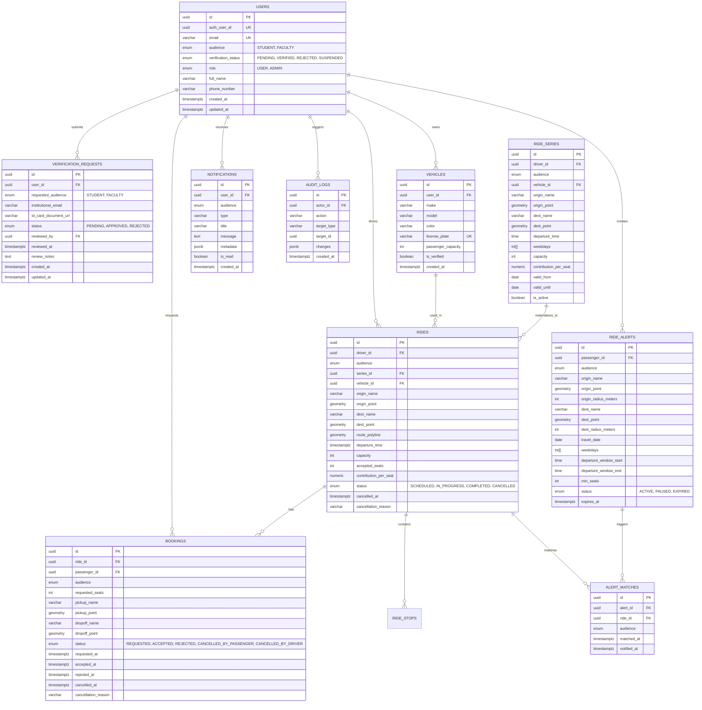
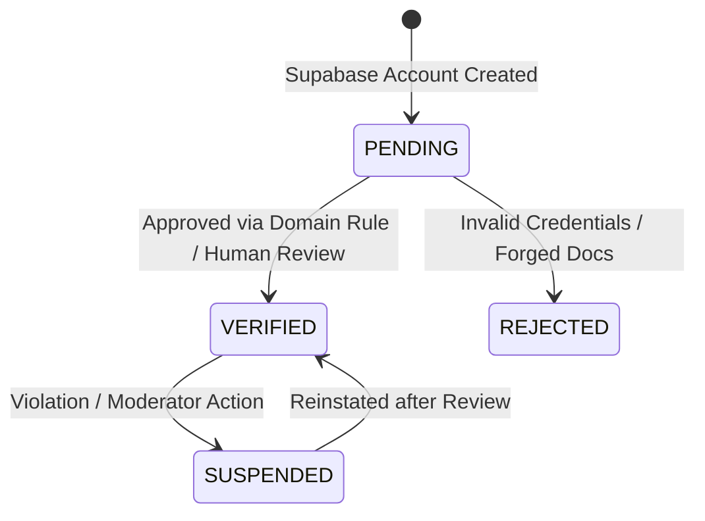
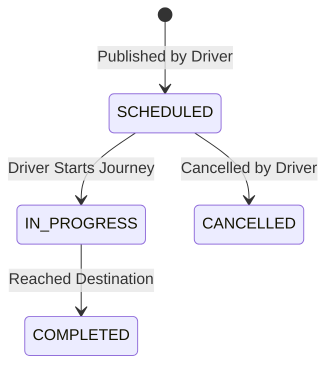
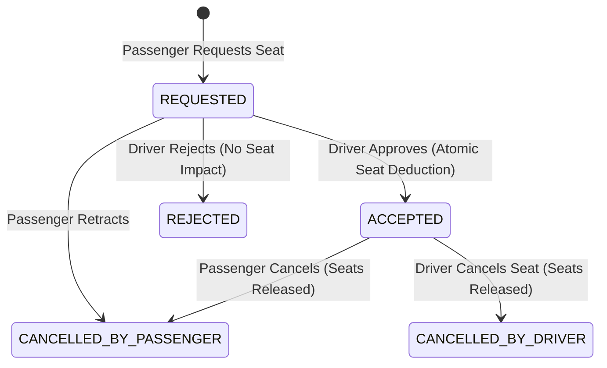

# Database Design & Schema Specification

## 1. Overview & Data Philosophy

The database design for the VIT Chennai Carpooling Platform uses PostgreSQL 16+ with the PostGIS 3.4+ extension. The primary design goal is **defense-in-depth**: critical business rules (such as audience isolation, capacity non-negativity, and booking state validity) must be guaranteed by the database schema itself, rather than relying exclusively on application-layer code.

---

## 2. Complete Entity Relationship Architecture



---

## 3. Database Schema Definitions & Constraints

### 3.1 Custom Types & Extensions
```sql
CREATE EXTENSION IF NOT EXISTS "uuid-ossp";
CREATE EXTENSION IF NOT EXISTS "postgis";

CREATE TYPE audience_type AS ENUM ('STUDENT', 'FACULTY');
CREATE TYPE verification_status_type AS ENUM ('PENDING', 'VERIFIED', 'REJECTED', 'SUSPENDED');
CREATE TYPE user_role_type AS ENUM ('USER', 'ADMIN');
CREATE TYPE ride_status_type AS ENUM ('SCHEDULED', 'IN_PROGRESS', 'COMPLETED', 'CANCELLED');
CREATE TYPE booking_status_type AS ENUM (
    'REQUESTED',
    'ACCEPTED',
    'REJECTED',
    'CANCELLED_BY_PASSENGER',
    'CANCELLED_BY_DRIVER'
);
CREATE TYPE alert_status_type AS ENUM ('ACTIVE', 'PAUSED', 'EXPIRED');
CREATE TYPE verification_request_status_type AS ENUM ('PENDING', 'APPROVED', 'REJECTED');
```

---

### 3.2 Audience Isolation via Composite Keys

To ensure that audience boundaries can never be violated even if application code has a bug, the database uses **composite unique keys** and **composite foreign keys**:

```sql
-- 1. Users table composite key:
ALTER TABLE users ADD CONSTRAINT uq_users_id_audience UNIQUE (id, audience);

-- 2. Rides table inherits audience from users:
ALTER TABLE rides ADD CONSTRAINT fk_rides_driver_audience 
    FOREIGN KEY (driver_id, audience) 
    REFERENCES users (id, audience) 
    ON DELETE RESTRICT;

ALTER TABLE rides ADD CONSTRAINT uq_rides_id_audience UNIQUE (id, audience);

-- 3. Bookings table enforces audience matches both ride AND passenger:
ALTER TABLE bookings ADD CONSTRAINT fk_bookings_passenger_audience 
    FOREIGN KEY (passenger_id, audience) 
    REFERENCES users (id, audience) 
    ON DELETE RESTRICT;

ALTER TABLE bookings ADD CONSTRAINT fk_bookings_ride_audience 
    FOREIGN KEY (ride_id, audience) 
    REFERENCES rides (id, audience) 
    ON DELETE RESTRICT;

-- 4. Ride Alerts enforce passenger audience:
ALTER TABLE ride_alerts ADD CONSTRAINT uq_ride_alerts_id_audience UNIQUE (id, audience);
ALTER TABLE ride_alerts ADD CONSTRAINT fk_ride_alerts_passenger_audience 
    FOREIGN KEY (passenger_id, audience) 
    REFERENCES users (id, audience) 
    ON DELETE CASCADE;

-- 5. Alert Matches enforce audience matches both:
ALTER TABLE alert_matches ADD CONSTRAINT fk_alert_matches_alert 
    FOREIGN KEY (alert_id, audience) 
    REFERENCES ride_alerts (id, audience) 
    ON DELETE CASCADE;

ALTER TABLE alert_matches ADD CONSTRAINT fk_alert_matches_ride 
    FOREIGN KEY (ride_id, audience) 
    REFERENCES rides (id, audience) 
    ON DELETE CASCADE;
```

---

### 3.3 Concurrency & Capacity Constraints

1. **Seat Non-Negativity & Limit**:
```sql
ALTER TABLE rides ADD CONSTRAINT chk_rides_accepted_seats_non_negative 
    CHECK (accepted_seats >= 0);

ALTER TABLE rides ADD CONSTRAINT chk_rides_capacity_not_exceeded 
    CHECK (accepted_seats <= capacity);

ALTER TABLE rides ADD CONSTRAINT chk_rides_positive_capacity 
    CHECK (capacity > 0 AND capacity <= 7);
```

2. **Self-Booking Prevention Trigger**:
```sql
CREATE OR REPLACE FUNCTION check_no_self_booking()
RETURNS TRIGGER AS $$
BEGIN
    IF EXISTS (
        SELECT 1 FROM rides WHERE id = NEW.ride_id AND driver_id = NEW.passenger_id
    ) THEN
        RAISE EXCEPTION 'Drivers cannot request seats on their own rides.';
    END IF;
    RETURN NEW;
END;
$$ LANGUAGE plpgsql;

CREATE TRIGGER trg_no_self_booking
BEFORE INSERT ON bookings
FOR EACH ROW
EXECUTE FUNCTION check_no_self_booking();
```

---

### 3.4 Controlled Manual Verification Fallback Schema
```sql
CREATE TABLE verification_requests (
    id UUID PRIMARY KEY DEFAULT uuid_generate_v4(),
    user_id UUID NOT NULL REFERENCES users(id) ON DELETE CASCADE,
    requested_audience audience_type NOT NULL,
    institutional_email VARCHAR(255) NOT NULL,
    id_card_document_url VARCHAR(1024) NOT NULL,
    status verification_request_status_type NOT NULL DEFAULT 'PENDING',
    reviewed_by UUID REFERENCES users(id) ON DELETE SET NULL,
    reviewed_at TIMESTAMPTZ,
    review_notes TEXT,
    created_at TIMESTAMPTZ NOT NULL DEFAULT NOW(),
    updated_at TIMESTAMPTZ NOT NULL DEFAULT NOW()
);

CREATE INDEX idx_verification_requests_status ON verification_requests(status);
CREATE INDEX idx_verification_requests_user ON verification_requests(user_id);
```

---

## 4. Geospatial Data Handling (PostGIS)

All spatial points and polylines use standard WGS 84 (`SRID 4326`):

1. **Columns**:
   * `origin_point`: `GEOMETRY(Point, 4326)`
   * `dest_point`: `GEOMETRY(Point, 4326)`
   * `route_polyline`: `GEOMETRY(LineString, 4326)`
2. **Spatial Indexes**:
```sql
CREATE INDEX idx_rides_origin_point ON rides USING GIST (origin_point);
CREATE INDEX idx_rides_dest_point ON rides USING GIST (dest_point);
CREATE INDEX idx_rides_route_polyline ON rides USING GIST (route_polyline);
CREATE INDEX idx_ride_alerts_origin_point ON ride_alerts USING GIST (origin_point);
CREATE INDEX idx_ride_alerts_dest_point ON ride_alerts USING GIST (dest_point);
```

3. **Spatial Query Pattern (Candidate Filtering)**:
```sql
-- Find rides within pickup radius and dropoff radius
SELECT r.*
FROM rides r
WHERE r.audience = :passenger_audience
  AND r.status = 'SCHEDULED'
  AND (r.capacity - r.accepted_seats) >= :requested_seats
  AND r.departure_time BETWEEN :departure_window_start AND :departure_window_end
  AND ST_DWithin(r.origin_point::geography, ST_SetSRID(ST_MakePoint(:p_lon, :p_lat), 4326)::geography, :max_pickup_distance)
  AND ST_DWithin(r.dest_point::geography, ST_SetSRID(ST_MakePoint(:d_lon, :d_lat), 4326)::geography, :max_dropoff_distance)
  -- Direction check: pickup must come before dropoff along the route
  AND (
      r.route_polyline IS NULL 
      OR ST_LineLocatePoint(r.route_polyline, ST_SetSRID(ST_MakePoint(:p_lon, :p_lat), 4326)) 
         < ST_LineLocatePoint(r.route_polyline, ST_SetSRID(ST_MakePoint(:d_lon, :d_lat), 4326))
  );
```

---

## 5. State Machines & Legal Transitions

### 5.1 Account Verification Status


### 5.2 Ride Status Lifecycle


### 5.3 Booking Status Transitions


---

## 6. Migration & Rollback Strategy

1. **Prisma Baseline**: Prisma manages base table DDL, standard columns, and TypeScript client typings.
2. **Explicit Custom SQL Migrations**: PostGIS columns, GIST indexes, triggers, and composite unique/foreign keys are stored in versioned `.sql` migrations in `packages/db/prisma/migrations/`.
3. **Idempotent Application**: All custom migrations use `IF NOT EXISTS` or transaction blocks.
4. **Rollback Procedures**: Each migration directory includes a documented `down.sql` script to revert schema changes cleanly without data loss when possible.
