# Comprehensive Development & Milestone Roadmap

## 1. Roadmap Overview & Execution Principles

This roadmap breaks down the development of the VIT Chennai Carpooling Platform into **8 incremental, verifiable milestones**. In accordance with core engineering principles:
* No milestone begins until previous milestone acceptance criteria and automated tests are passing.
* Application code is developed incrementally, testing each component in isolation before integration.
* All database interactions are tested against a real PostgreSQL + PostGIS instance (never mocked away).
* Security invariants are verified continuously.

---

## 2. Detailed Milestone Breakdown

```mermaid
gantt
    title Platform Implementation Roadmap
    dateFormat  X
    axisFormat %d
    section Planning
    Milestone 0 - Discovery & Documentation       :active, 0, 1
    section Foundation
    Milestone 1 - Monorepo & Local PostGIS Core   :1, 2
    Milestone 2 - Identity, Auth & Verification   :2, 3
    section Core Ride Features
    Milestone 3 - Vehicles & One-Time Rides       :3, 4
    Milestone 4 - Bookings & Atomic Concurrency   :4, 5
    section Alerts & Notifications
    Milestone 5 - Ride Alerts & Notification Inbox :5, 6
    section Commuting Scale
    Milestone 6 - Recurring Commute Engine        :6, 7
    section Safety & Production
    Milestone 7 - Moderation, Safety & Pilot Launch:7, 8
```

---

### Milestone 0: Discovery, Architecture & Invariants Documentation (CURRENT)
* **Goal**: Establish full product context, inspect the developer's macOS environment, audit prerequisites, produce architectural blueprints, and formalize security invariants.
* **Key Deliverables**:
  * [x] Environment inspection (OS, Node, package managers, Docker, database availability).
  * [x] `README.md`
  * [x] `docs/SECURITY-INVARIANTS.md`
  * [x] `docs/ARCHITECTURE.md`
  * [x] `docs/DATABASE-DESIGN.md`
  * [x] `docs/DECISIONS.md`
  * [x] `docs/DEVELOPMENT-PLAN.md`
* **Exit Criteria**: Developer reviews and signs off on architecture, database constraints, and the milestone progression. Zero application code or database migrations generated in this phase.

---

### Milestone 1: Monorepo Foundation & Database Initialization (COMPLETED)
* **Goal**: Initialize the project monorepo with pnpm workspaces, configure NestJS API, configure Vite React frontend, set up containerized PostgreSQL 16 + PostGIS on Apple Silicon, and implement end-to-end health check.
* **Components & Packages Delivered**:
  * [x] Root: `package.json`, `pnpm-workspace.yaml`, `tsconfig.base.json`, `.gitignore`, `docker-compose.yml`, `.env.example`, `.env`.
  * [x] `docker/postgres`: Custom `Dockerfile` based on Debian Bookworm with native `arm64/v8` PostGIS 3.6.4 and `init-databases.sh`.
  * [x] `packages/contracts`: Shared TypeScript types, Zod schemas, DTOs (`HealthResponse`, `AudienceType`).
  * [x] `packages/db`: Prisma schema configured with PostGIS/UUID extensions and local client output.
  * [x] `apps/api`: NestJS API shell, Zod environment validation, Swagger UI at `/api/docs`, health check at `/health`.
  * [x] `apps/web`: Vite + React 18 + TypeScript PWA template, vanilla CSS design tokens, TanStack Query provider, responsive layout shell.
* **Acceptance Criteria Verified**:
  * [x] `pnpm install` succeeds across all 5 workspace projects without conflicts.
  * [x] Containerized PostgreSQL + PostGIS starts, passes health checks on port 5433, and initializes `vit_carpool_dev`, `vit_carpool_test`, and `vit_carpool_shadow`.
  * [x] Volume persistence verified across container restarts.
  * [x] `pnpm typecheck` passes with zero errors across all packages.
  * [x] `pnpm test` (e2e integration test) passes with 200 OK and verifies PostGIS version `3.6.4`.
  * [x] Vite frontend renders mobile-first responsive shell, connects to API `/health`, and verifies interactive refetching via browser subagent.

---

### Milestone 2: Identity, Supabase Auth & Configurable Verification Engine
* **Goal**: Implement server-side JWT verification, trusted application user record synchronization, configurable automatic institutional email classification, and controlled manual verification fallback with absolute audience immutability.
* **Components & Packages**:
  * `packages/db`: `users`, `verification_requests`, `audit_logs` tables and composite keys `(id, audience)`.
  * `apps/api`: `AuthModule`, `UsersModule`, `VerificationModule`, `SupabaseAuthGuard`, `VerifiedUserGuard`, `AudienceGuard`, configurable email classification rule engine.
  * `apps/web`: Login/Register view (institutional email OTP), unverified "Pending Verification / Upload Campus ID" screen, verification status badge, protected routes. (Zero audience selection UI).
* **Acceptance Criteria**:
  * Server verifies JWT signature using Supabase JWKS; invalid tokens are rejected with `401 Unauthorized`.
  * Application user record is created/loaded by `auth_user_id`; audience is determined solely on the server.
  * Configurable email pattern matcher automatically assigns `STUDENT` or `FACULTY` audience when institutional email matches confirmed formats.
  * Zero client audience self-assignment: API rejects client-supplied audience fields; frontend contains no audience dropdown.
  * Controlled manual verification fallback: Users without auto-matched patterns or blocked OTP can submit ID card proof to `verification_requests`; administrators approve/reject with audit logging.
  * Unverified users (`PENDING`) are blocked from ride and booking endpoints.
  * Integration tests prove student tokens cannot access faculty user data or endpoints, and vice versa.

---

### Milestone 3: Vehicle Management & One-Time Ride Publishing
* **Goal**: Enable drivers to register verified vehicles, publish scheduled one-time rides with origin/destination coordinates, and enable passengers to search rides with PostGIS spatial filtering.
* **Components & Packages**:
  * `packages/db`: `vehicles`, `rides`, `ride_stops` tables, PostGIS columns (`origin_point`, `dest_point`, `route_polyline`), GIST spatial indexes.
  * `apps/api`: `VehiclesModule`, `RidesModule`, `GeoModule` (decoupled routing/geocoding interface).
  * `apps/web`: "Offer a Ride" multi-step flow (origin, destination, date/time, vehicle selection, seat count, contribution), ride search screen with date/time pickers and radius sliders, ride detail view.
* **Acceptance Criteria**:
  * Driver can publish a ride only with their own registered vehicle and capacity within vehicle limits.
  * Published ride automatically inherits driver's audience via database composite constraint.
  * Search endpoint searches exclusively within the authenticated user's audience.
  * PostGIS spatial query (`ST_DWithin`) accurately finds rides within radius and verifies direction (`ST_LineLocatePoint`).
  * Automated tests prove student search returns 0 faculty rides, and faculty search returns 0 student rides.

---

### Milestone 4: Booking Workflow & Concurrency Protection
* **Goal**: Implement the request-and-approval booking lifecycle with atomic seat allocation and race-condition immunity.
* **Components & Packages**:
  * `packages/db`: `bookings` table, composite foreign keys `(ride_id, audience)` & `(passenger_id, audience)`, capacity check constraints.
  * `apps/api`: `BookingsModule`, transactional approval handler with row locking (`SELECT FOR UPDATE`), cancellation handlers.
  * `apps/web`: "Request Seat" modal, Driver "Booking Requests" management dashboard, Passenger "My Rides" status tracker.
* **Acceptance Criteria**:
  * Passenger can request seats up to available capacity; booking starts in `REQUESTED` status (zero seat deduction).
  * Driver can approve or reject requests for their own rides only.
  * Seat deduction occurs atomically in a transaction; driver approval transitions booking to `ACCEPTED` and increments `accepted_seats`.
  * Cancelling an accepted booking releases seats exactly once.
  * Concurrency test: 10 concurrent requests for the last available seat result in exactly 1 acceptance and 9 safe rejections without overbooking.

---

### Milestone 5: Ride Alerts & Notification Inbox
* **Goal**: Enable passengers to register ride alerts for unmet commute routes, automatically match newly published rides to active alerts via background jobs, and dispatch in-app notifications.
* **Components & Packages**:
  * `packages/db`: `ride_alerts`, `alert_matches`, `notifications` tables.
  * `apps/api`: `AlertsModule`, `NotificationsModule`, `pg-boss` background worker for `match-ride-alerts`.
  * `apps/web`: "Create Ride Alert" form, "Active Alerts" list, in-app notification center bell icon with unread count badge.
* **Acceptance Criteria**:
  * Passenger can create an alert with spatial radius and time window.
  * Alert audience matches passenger audience via composite key.
  * When a driver publishes a ride, `match-ride-alerts` job identifies compatible alerts within the same audience and creates `alert_matches` records.
  * In-app notification inbox displays alert matches with deduplication.
  * Zero cross-audience notification leaks.

---

### Milestone 6: Recurring Commutes & Materialization Engine
* **Goal**: Support regular weekday campus commutes through recurring series templates that project individual bookable ride occurrences over a rolling horizon.
* **Components & Packages**:
  * `packages/db`: `ride_series` table, recurring template schema.
  * `apps/api`: `RecurringModule`, nightly `pg-boss` materialization job (`materialize-recurring-rides`).
  * `apps/web`: "Create Recurring Commute" UI (select weekdays, validity date range, default departure time), calendar-based view of upcoming ride occurrences.
* **Acceptance Criteria**:
  * Driver creates a recurring series for specified weekdays (e.g., Mon-Fri at 07:45 AM).
  * Background job materializes individual ride occurrences up to 14 days in advance.
  * Cancelling one occurrence marks it cancelled and prevents the materialization job from recreating it.
  * Terminating or pausing a series prevents future ride generation.
  * Each materialized occurrence enforces standard booking and capacity rules independently.

---

### Milestone 7: Safety, Moderation, Audit Logging & Pilot Launch Readiness
* **Goal**: Implement user blocking, report submission, administrative moderation tools, audit logging, privacy redactions, and comprehensive end-to-end testing.
* **Components & Packages**:
  * `packages/db`: `reports`, `blocks`, `audit_logs` tables.
  * `apps/api`: `ModerationModule`, `AdminModule`, admin authorization guards, structured audit logging interceptor.
  * `apps/web`: User reporting dialog, block user option, Admin review console (identity verification requests, reported users).
* **Acceptance Criteria**:
  * Blocked users cannot see or book each other's rides.
  * Admin dashboard allows authorized admins to review verification requests and approve/reject audience credentials.
  * All sensitive admin actions write immutable audit log records.
  * Public APIs redact residential pickup details from unaccepted users.
  * End-to-end test suite passes 100% of security, audience isolation, and concurrency tests.
  * PWA audit achieves 100% score for installability and responsive mobile usability.
