# Comprehensive Development & Milestone Roadmap

## 1. Roadmap Overview & Execution Principles

This roadmap breaks down the development of the VIT Chennai Carpooling Platform into **8 incremental, verifiable milestones**. In accordance with core engineering principles:
* No milestone begins until previous milestone acceptance criteria and automated tests are passing.
* Application code is developed incrementally, testing each component in isolation before integration.
* All database interactions are tested against a real PostgreSQL + PostGIS instance (never mocked away).
* Security invariants are verified continuously.

---

## 2. Detailed Milestone Breakdown

```mermaid
gantt
    title Platform Implementation Roadmap
    dateFormat  X
    axisFormat %d
    section Planning
    Milestone 0 - Discovery & Documentation       :active, 0, 1
    section Foundation
    Milestone 1 - Monorepo & Local PostGIS Core   :1, 2
    Milestone 2 - Identity, Auth & Verification   :2, 3
    section Core Ride Features
    Milestone 3 - Vehicles & One-Time Rides       :3, 4
    Milestone 4 - Bookings & Atomic Concurrency   :4, 5
    section Alerts & Notifications
    Milestone 5 - Ride Alerts & Notification Inbox :5, 6
    section Commuting Scale
    Milestone 6 - Recurring Commute Engine        :6, 7
    section Safety & Production
    Milestone 7 - Moderation, Safety & Pilot Launch:7, 8
```

---

### Milestone 0: Discovery, Architecture & Invariants Documentation (CURRENT)
* **Goal**: Establish full product context, inspect the developer's macOS environment, audit prerequisites, produce architectural blueprints, and formalize security invariants.
* **Key Deliverables**:
  * [x] Environment inspection (OS, Node, package managers, Docker, database availability).
  * [x] `README.md`
  * [x] `docs/SECURITY-INVARIANTS.md`
  * [x] `docs/ARCHITECTURE.md`
  * [x] `docs/DATABASE-DESIGN.md`
  * [x] `docs/DECISIONS.md`
  * [x] `docs/DEVELOPMENT-PLAN.md`
* **Exit Criteria**: Developer reviews and signs off on architecture, database constraints, and the milestone progression. Zero application code or database migrations generated in this phase.

---

### Milestone 1: Monorepo Foundation & Database Initialization (COMPLETED)
* **Goal**: Initialize the project monorepo with pnpm workspaces, configure NestJS API, configure Vite React frontend, set up containerized PostgreSQL 16 + PostGIS on Apple Silicon, and implement end-to-end health check.
* **Components & Packages Delivered**:
  * [x] Root: `package.json`, `pnpm-workspace.yaml`, `tsconfig.base.json`, `.gitignore`, `docker-compose.yml`, `.env.example`, `.env`.
  * [x] `docker/postgres`: Custom `Dockerfile` based on Debian Bookworm with native `arm64/v8` PostGIS 3.6.4 and `init-databases.sh`.
  * [x] `packages/contracts`: Shared TypeScript types, Zod schemas, DTOs (`HealthResponse`, `AudienceType`).
  * [x] `packages/db`: Prisma schema configured with PostGIS/UUID extensions and local client output.
  * [x] `apps/api`: NestJS API shell, Zod environment validation, Swagger UI at `/api/docs`, health check at `/health`.
  * [x] `apps/web`: Vite + React 18 + TypeScript PWA template, vanilla CSS design tokens, TanStack Query provider, responsive layout shell.
* **Acceptance Criteria Verified**:
  * [x] `pnpm install` succeeds across all 5 workspace projects without conflicts.
  * [x] Containerized PostgreSQL + PostGIS starts, passes health checks on port 5433, and initializes `vit_carpool_dev`, `vit_carpool_test`, and `vit_carpool_shadow`.
  * [x] Volume persistence verified across container restarts.
  * [x] `pnpm typecheck` passes with zero errors across all packages.
  * [x] `pnpm test` (e2e integration test) passes with 200 OK and verifies PostGIS version `3.6.4`.
  * [x] Vite frontend renders mobile-first responsive shell, connects to API `/health`, and verifies interactive refetching via browser subagent.

---

### Milestone 2: Identity, Supabase Auth & Configurable Verification Engine
* **Goal**: Implement server-side JWT verification, trusted application user record synchronization, configurable automatic institutional email classification, and controlled manual verification fallback with absolute audience immutability.
* **Components & Packages**:
  * `packages/db`: `users`, `verification_requests`, `audit_logs` tables, composite keys `(id, audience)`, check constraints, participation triggers, and immutability triggers.
  * `apps/api`: `AuthModule`, `UsersModule`, `VerificationModule`, `SupabaseAuthGuard`, `VerifiedUserGuard`, `AudienceGuard`, configurable email classification rule engine (`STUDENT_EMAIL_REGEX`, `FACULTY_EMAIL_REGEX`, `ENABLE_AUTOMATIC_EMAIL_CLASSIFICATION`).
  * `apps/web`: Login/Register view (institutional email OTP), unverified "Pending Verification / Upload Campus ID" screen, verification status badge, protected routes. (Zero audience selection UI).
  * Storage: Private bucket `id-documents` with signed URL access and 30-day document purge lifecycle.
* **Acceptance Criteria**:
  * Server verifies JWT signature using Supabase JWKS; invalid tokens are rejected with `401 Unauthorized`.
  * Application user record is created/loaded by `auth_user_id`; audience is determined solely on the server.
  * **Observed Email Formats & Configurable Classification**:
    * Configurable via environment variables: `STUDENT_EMAIL_REGEX`, `FACULTY_EMAIL_REGEX`.
    * Default `ENABLE_AUTOMATIC_EMAIL_CLASSIFICATION=false` until VIT Chennai patterns are confirmed.
    * Fail-safe: If both match, neither matches, or automatic classification is disabled, user remains `PENDING` with `audience = NULL`.
    * Email domain NEVER infers `ADMIN` privileges.
  * **Audience Assignment vs. Account Status Separation**:
    * Non-`VERIFIED` accounts are NOT required to have `audience = NULL`. Suspended users retain their verified audience in the database to preserve historical foreign key integrity, but are blocked from protected features.
  * **Controlled Email Mutation**:
    * Modifying an email never transfers a user between student and faculty groups.
    * Email change immediately sets status to `PENDING` re-verification, revoking carpooling capabilities, and records a transactional audit log.
  * **Controlled Manual Verification Fallback & Evidence Privacy**:
    * Unmatched users submit ID card evidence to `verification_requests`.
    * Evidence stored in private bucket `id-documents`; accessible only to admins via 15-minute signed URLs.
    * Physical document files are permanently purged 30 days after `APPROVED` or `REJECTED` decision.
  * **Transactional & Role-Protected Audit Logging**:
    * Sensitive state changes are logged transactionally in the same DB transaction.
    * Database triggers block `UPDATE` and `DELETE` on `audit_logs`; application database role has `REVOKE UPDATE, DELETE, TRUNCATE`.
    * `actor_id` is decoupled from cascading foreign keys to prevent trigger deadlocks upon user privacy erasure.
  * **Email Normalization & Case-Insensitive Uniqueness**:
    * Mandatory server-side normalization (`.trim().toLowerCase()`) on all write paths (signup, login sync, webhooks, verification requests).
    * Database constraint `CHECK (email = LOWER(email))` rejects unnormalized inserts.
    * Automated tests assert direct mixed-case insertion fails DB check constraint.
  * **Email-Change Concurrency & Sequence Reconciliation**:
    * Authoritative sequence tracking via `auth_updated_at` with row locking (`SELECT FOR UPDATE`).
    * Stale out-of-order events are dropped; duplicate events are idempotent no-ops.
    * **Ambiguous Event Reconciliation**: Events with identical timestamps but conflicting emails trigger an authoritative fetch to `supabase.auth.admin.getUserById()`. Carpooling access remains strictly revoked until verified.
    * Automated tests assert that stale webhooks cannot restore access, and ambiguous timestamp conflicts resolve authoritatively.
  * **Runtime Role Privilege Verification**:
    * Table ownership belongs to migration role; `app_user` is a non-owner with least-privilege DML.
    * Automated integration tests connect as `app_user` to assert that `UPDATE`, `DELETE`, `TRUNCATE`, `ALTER TABLE DISABLE TRIGGER`, and `CREATE TABLE` are strictly rejected with permission denied.
  * **Verification State Transitions & Recovery**:
    * Automated tests validate all 5 states of `chk_users_verification_state` (Active verified, Suspended, Rejected, Initial pending, Re-verification pending) and assert that unverified or suspended users can never participate in carpooling.
    * Migration failures follow the forward-fix discipline; `down.sql` serves as a human-reviewed recovery runbook with zero automated destructive rollback.

---

### Milestone 3: Vehicle Management & One-Time Ride Publishing
* **Goal**: Enable drivers to register verified vehicles, publish scheduled one-time rides with origin/destination coordinates, and enable passengers to search rides with PostGIS spatial filtering.
* **Components & Packages**:
  * `packages/db`: `vehicles`, `rides`, `ride_stops` tables, PostGIS columns (`origin_point`, `dest_point`, `route_polyline`), GIST spatial indexes.
  * `apps/api`: `VehiclesModule`, `RidesModule`, `GeoModule` (decoupled routing/geocoding interface).
  * `apps/web`: "Offer a Ride" multi-step flow (origin, destination, date/time, vehicle selection, seat count, contribution), ride search screen with date/time pickers and radius sliders, ride detail view.
* **Acceptance Criteria**:
  * Driver can publish a ride only with their own registered vehicle and capacity within vehicle limits.
  * Published ride automatically inherits driver's audience via database composite constraint.
  * Search endpoint searches exclusively within the authenticated user's audience.
  * PostGIS spatial query (`ST_DWithin`) accurately finds rides within radius and verifies direction (`ST_LineLocatePoint`).
  * Automated tests prove student search returns 0 faculty rides, and faculty search returns 0 student rides.

---

### Milestone 4: Booking Workflow & Concurrency Protection
* **Goal**: Implement the request-and-approval booking lifecycle with atomic seat allocation and race-condition immunity.
* **Components & Packages**:
  * `packages/db`: `bookings` table, composite foreign keys `(ride_id, audience)` & `(passenger_id, audience)`, capacity check constraints.
  * `apps/api`: `BookingsModule`, transactional approval handler with row locking (`SELECT FOR UPDATE`), cancellation handlers.
  * `apps/web`: "Request Seat" modal, Driver "Booking Requests" management dashboard, Passenger "My Rides" status tracker.
* **Acceptance Criteria**:
  * Passenger can request seats up to available capacity; booking starts in `REQUESTED` status (zero seat deduction).
  * Driver can approve or reject requests for their own rides only.
  * Seat deduction occurs atomically in a transaction; driver approval transitions booking to `ACCEPTED` and increments `accepted_seats`.
  * Cancelling an accepted booking releases seats exactly once.
  * Concurrency test: 10 concurrent requests for the last available seat result in exactly 1 acceptance and 9 safe rejections without overbooking.

---

### Milestone 5: Ride Alerts & Notification Inbox
* **Goal**: Enable passengers to register ride alerts for unmet commute routes, automatically match newly published rides to active alerts via background jobs, and dispatch in-app notifications.
* **Components & Packages**:
  * `packages/db`: `ride_alerts`, `alert_matches`, `notifications` tables.
  * `apps/api`: `AlertsModule`, `NotificationsModule`, `pg-boss` background worker for `match-ride-alerts`.
  * `apps/web`: "Create Ride Alert" form, "Active Alerts" list, in-app notification center bell icon with unread count badge.
* **Acceptance Criteria**:
  * Passenger can create an alert with spatial radius and time window.
  * Alert audience matches passenger audience via composite key.
  * When a driver publishes a ride, `match-ride-alerts` job identifies compatible alerts within the same audience and creates `alert_matches` records.
  * In-app notification inbox displays alert matches with deduplication.
  * Zero cross-audience notification leaks.

---

### Milestone 6: Recurring Commutes & Materialization Engine
* **Goal**: Support regular weekday campus commutes through recurring series templates that project individual bookable ride occurrences over a rolling horizon.
* **Components & Packages**:
  * `packages/db`: `ride_series` table, recurring template schema.
  * `apps/api`: `RecurringModule`, nightly `pg-boss` materialization job (`materialize-recurring-rides`).
  * `apps/web`: "Create Recurring Commute" UI (select weekdays, validity date range, default departure time), calendar-based view of upcoming ride occurrences.
* **Acceptance Criteria**:
  * Driver creates a recurring series for specified weekdays (e.g., Mon-Fri at 07:45 AM).
  * Background job materializes individual ride occurrences up to 14 days in advance.
  * Cancelling one occurrence marks it cancelled and prevents the materialization job from recreating it.
  * Terminating or pausing a series prevents future ride generation.
  * Each materialized occurrence enforces standard booking and capacity rules independently.

---

### Milestone 7 / Milestone 13: Trust, Safety, User Blocking, Reporting & Admin Moderation (COMPLETED)
* **Goal**: Implement a complete, secure, integrated trust and safety system: user blocking with mutual invisibility semantics, confidential user and incident reporting, administrative moderation queue, ID card verification review, server-side account suspension, and append-only audit logging.
* **Components & Packages Delivered**:
  * `packages/db`: `blocks`, `reports` tables, `ReportCategory`, `ReportStatus` enums, user suspension fields (`is_suspended`, `suspension_reason`, `suspended_at`, `suspended_by`), database migration `20261028160000_add_trust_safety_and_moderation`.
  * `packages/contracts`: `BlockResponseSchema`, `BlockStatusResponseSchema`, `ReportCategorySchema`, `ReportStatusSchema`, `CreateReportSchema`, `ReportResponseSchema`, `ResolveReportSchema`, `SuspendUserSchema`, `AdminUserSummarySchema`.
  * `apps/api`:
    * `ModerationModule` (`ModerationService`, `ModerationController`): Mutual blocking semantics, list/unblock, report submission with target validation and duplicate flood prevention.
    * `AdminModule` (`AdminService`, `AdminController`): Verification request approval/rejection with secure preview, incident report queue with investigation and resolution, user search and account suspension/reinstatement.
    * Real-time suspension enforcement: `VerifiedUserGuard` and `AdminGuard` check persistent account suspension state, immediately invalidating access for previously issued RS256 JWTs without requiring signing key rotation.
    * Cross-module block enforcement: `RidesService` (discovery filtering & 404 details), `BookingsService` (403 `BOOKING_NOT_PERMITTED`), `ChatService` (403 `CONVERSATION_BLOCKED` & read-only history), `RideAlertsMatcherService` (alert exclusion in SQL), `RatingsService` (403 `RATING_BLOCKED`).
  * `apps/web`:
    * `AdminDashboardPage` (`/admin`): 3-tab responsive administrative moderation suite (Verification Queue with secure preview, Incident Reports Queue with status/category filters & resolution notes, User Management with paginated search & suspension dialogs).
    * Protected `/admin` frontend route guarded by `<ProtectedRoute requireAdmin>`.
    * Admin navigation item dynamically rendered in Navbar for `role === 'ADMIN'`.
    * User-facing safety experience: `ReportModal`, `BlockConfirmModal`, "Blocked Members" list in `ProfilePage` with unblock actions, report & block quick actions in `MessagesPage` conversation header.
* **Acceptance Criteria Verified**:
  * [x] Mutual invisibility and interaction blocking verified in both directions across ride search, ride details, booking creation, private chat, ratings, and ride alert matching.
  * [x] Structured reporting persists through defined lifecycle (`PENDING` -> `INVESTIGATING` -> `RESOLVED` / `DISMISSED`) with confidential notes.
  * [x] Instant server-side revocation: Suspended accounts cannot execute protected APIs even with unexpired valid RS256 JWTs.
  * [x] Role protection: Non-admins (students and faculty) receive 403 Forbidden on all `/admin/*` endpoints.
  * [x] All moderation operations write immutable, append-only records to `audit_logs`.
  * [x] Zero cross-audience or personal data leaks in block lists or report queues.
  * [x] Automated test suite: `moderation.e2e-spec.ts` (26/26 tests passing) and all 16 regression test suites (404/404 tests passing, total 430/430 passing).

