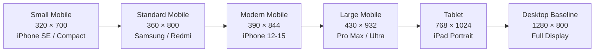

# VIT Carpool — Mobile Responsiveness Audit & UI/UX Remediation Report

**Date of Audit:** November 9, 2026  
**Application:** VIT Chennai Carpool (`@vit-carpool`)  
**Auditor:** Antigravity Mobile Engineering & QA  
**Audit Scope:** Complete Application-Wide Mobile Responsiveness, Multi-Device Matrix, Interactive Modals, Admin Operations Portal, and Desktop Regression Verification  
**Status:** **PASSED — PRODUCTION READY**

---

## 1. Executive Summary & Audit Scope

A comprehensive, application-wide mobile responsiveness audit and UI/UX remediation was conducted across the entire VIT Chennai Carpool platform. The objective of this milestone was to elevate the application from a desktop-centric responsive layout into a polished, production-grade mobile web application capable of delivering an intuitive, touch-first user experience on all mobile devices commonly used by VIT Chennai students, faculty, and administrative staff.

The audit was executed using real Chromium browser automation driven by Playwright (`@playwright/test`), evaluating every route and interactive component under authentic browser rendering conditions. A total of **156 direct page/view configurations** (26 distinct views across 6 viewports) and all interactive modals, drawers, and form cards were tested.

### Key Audit Highlights:
- **Zero Horizontal Overflow:** All 18 registered application routes, 8 admin dashboard workspace tabs, and all modals achieved `0px` horizontal layout overflow (`diff: 0px`, `scrollWidth === clientWidth`).
- **Admin Console Mobile Modernization:** Resolved severe mobile clipping on the separate administrative operations console (`/admin`), transforming a rigid 260px desktop sidebar into a mobile horizontal pill-bar navigation and wrapping all management tables in smooth touch-momentum scroll containers.
- **Form Card Padding Normalization:** Replaced hardcoded desktop padding (`24px`–`28px`) on ride creation forms with a responsive card system (`.form-card-responsive`), reclaiming critical horizontal screen real estate on compact viewports ($\le 360\text{px}$).
- **Location Search Optimization:** Fixed search suggestion ranking to prioritize authoritative Chennai commuter transit hubs (Vandalur, Tambaram, Guindy, Airport) over commercial retail noise, widened the dropdown to `min(580px, calc(100vw - 32px))` with dynamic viewport boundary clamping, and eliminated text ellipsis truncation.
- **5-Item Bottom Navigation Integrity:** Verified that both unauthenticated and authenticated five-item bottom navigation bars remain perfectly anchored, touch-accessible, and intact across all mobile viewports without desktop regression.

---

## 2. Complete Application Discovery & Route Inventory

A complete inspection of the frontend codebase (`apps/web/src/App.tsx`, `apps/web/src/pages/`, `apps/web/src/features/`) identified all registered application routes, user cohorts, and interactive modal systems:

### A. Route Inventory by Cohort

| Route Path | Page Component | Access Cohort | Primary Function & Mobile Considerations |
|:---|:---|:---|:---|
| `/` | `LandingPage.tsx` | Public | Hero showcase, transit corridors, fast-entry search bar, campus verification trust pill |
| `/auth` | `AuthPage.tsx` | Public | Institutional sign-in with email OTP, responsive single-column card layout |
| `/how-it-works` | `HowItWorksPage.tsx` | Public | Step-by-step commuter guide, driver/passenger cards, corridor explanations |
| `/safety` | `SafetyPage.tsx` | Public | Campus safety protocols, emergency guidelines, community moderation standards |
| `/rides` | `RidesPage.tsx` | Public / Auth | Campus ride search, corridor matching filters, transit cards, cab share join actions |
| `/admin/login` | `AdminLoginPage.tsx` | Public | Dedicated administrative portal login with 2FA TOTP authentication |
| `/dashboard` | `DashboardPage.tsx` | Student / Faculty | Commuter status overview, quick ride actions, upcoming trips, metrics carousel |
| `/profile` | `ProfilePage.tsx` | Student / Faculty | User trust score, verified badges, rating breakdown, emergency contact editor |
| `/notifications` | `NotificationsPage.tsx` | Student / Faculty | In-app notification center, unread indicators, automated read-state transitions |
| `/offer-ride` | `OfferRidePage.tsx` | Student / Faculty | Multi-mode ride creation: Vehicle Quick Ride, Custom Route, and Shared Cab forms |
| `/my-rides` | `MyRidesPage.tsx` | Student / Faculty | Host/Driver dashboard, passenger request management, dynamic fare updates |
| `/bookings` | `BookingsPage.tsx` | Student / Faculty | Passenger trip management, boarding pass inspection, fare revision acknowledgement |
| `/vehicles` | `VehiclesPage.tsx` | Student / Faculty | Personal vehicle garage, registration verification, vehicle photo upload |
| `/recurring-commutes`| `RecurringCommutesPage.tsx` | Student / Faculty | Scheduled weekly commute templates, automated ride generation rules |
| `/messages` | `MessagesPage.tsx` | Student / Faculty | Direct messaging inbox, active conversation thread viewport, touch message input |
| `/ride-alerts` | `RideAlertsPage.tsx` | Student / Faculty | Corridor notification triggers for upcoming unlisted commuter routes |
| `/rides/:id/track` | `RideTrackingPage.tsx` | Student / Faculty | Real-time GPS ride tracking map, live ETA, proximity boarding OTP card |
| `/admin` | `AdminDashboardPage.tsx` | Admin / SuperAdmin | Operations center (Users, Rides, Bookings, Safety Moderation, Audit, Health) |

### B. Interactive Modals, Drawers & Overlays Inventory
1. **LocationAutocomplete Dropdown:** Intelligent geocoding combobox with category badges and boundary clamping.
2. **Search Results Filter Modal (`SearchResultsModal.tsx`):** Corridor mode, departure time, seat count, and vehicle filters.
3. **Ride Details Modal (`RideDetailsModal.tsx`):** Detailed route polyline, driver safety credentials, vehicle trust indicators.
4. **Seat Booking Request Modal (`BookingsModal.tsx`):** Seat quantity selector, pickup point notes, instant booking submission.
5. **Dynamic Fare Update Modal (`MyRidesPage.tsx`):** Commercial cab total fare revision with automated passenger cost splitting.
6. **Passenger Requests Modal (`MyRidesPage.tsx`):** Host approval/rejection interface with seat capacity alerts.
7. **Boarding Pass Modal (`BookingsPage.tsx`):** High-contrast 4-digit boarding OTP, QR verification, vehicle details.
8. **User Moderation & Reporting Modals (`ReportModal.tsx`, `BlockConfirmModal.tsx`):** Community safety incident reporting.
9. **Driver Rating Modal (`RateDriverModal.tsx`):** Commute feedback, 5-star scoring, institutional trust tags.
10. **Developer Diagnostics Drawer (`DevDiagnosticsDrawer.tsx`):** Real-time WebSocket connection state, push subscription logs.

---

## 3. Target Viewports & Responsive Breakpoints Matrix

All testing and evidence capture was executed across six standardized viewport dimensions:



| Viewport Profile | Width × Height | Primary Device Archetypes | Layout Mode Verified |
|:---|:---:|:---|:---|
| **Small Mobile** | `320 × 700` | iPhone SE (1st gen), older Android phones | Single column, compact padding (12px), stacked actions, bottom nav |
| **Standard Mobile** | `360 × 800` | Samsung Galaxy A/S, Xiaomi Redmi | Single column, standard mobile padding (16px), bottom nav |
| **Modern Mobile** | `390 × 844` | iPhone 12 / 13 / 14 / 15 / 16 standard | Single column, optimal mobile card spacing, bottom nav |
| **Large Mobile** | `430 × 932` | iPhone Pro Max, Samsung Galaxy S Ultra | Single column with relaxed typography, bottom nav |
| **Tablet** | `768 × 1024` | Apple iPad (portrait), Android tablets | Split column layouts, top navigation bar, bottom nav suppressed |
| **Desktop Baseline** | `1280 × 800` | Laptops / Workstations / External monitors | Full desktop grid, sidebar/header navigation, regression verified |

---

## 4. Navigation Architecture & 5-Item Bottom Navigation Verification

The application implements a strict, context-aware five-item bottom navigation system that delivers instant single-thumb reachability across all primary features on mobile devices ($\le 640\text{px}$).

### A. Navigation Item Mapping by Authentication State

1. **Unauthenticated Public State:**
   - **Tab 1: Home (`/`)** — Landing page hero, search shortcuts, and platform highlights.
   - **Tab 2: Find Rides (`/rides`)** — Corridor-based campus ride search and public listings.
   - **Tab 3: Guide (`/how-it-works`)** — Student carpooling and cab sharing explanatory guide.
   - **Tab 4: Safety (`/safety`)** — Institutional safety protocols and emergency resources.
   - **Tab 5: Sign In (`/auth`)** — Direct institutional login entry point.

2. **Authenticated Student/Faculty State:**
   - **Tab 1: Dashboard (`/dashboard`)** — Personal commute overview and status metrics.
   - **Tab 2: Find Rides (`/rides`)** — Campus ride discovery, corridor filters, and live bookings.
   - **Tab 3: My Trips (`/bookings`)** — Passenger bookings, boarding passes, and fare acknowledgements.
   - **Tab 4: Inbox (`/messages`)** — Direct peer messaging and ride coordination threads.
   - **Tab 5: Profile (`/profile`)** — User identity, trust rating, vehicle garage, and security settings.

### B. Mobile Bottom Navigation Verification Findings
- **Fixed Positioning & Viewport Clamping:** Bottom navigation bar maintains `position: fixed; bottom: 0; left: 0; right: 0; z-index: 100; height: 60px;` with safe-area inset padding (`padding-bottom: env(safe-area-inset-bottom, 0px)`).
- **Page Bottom Spacing:** All pages utilize `margin-bottom: 72px` or `.bottom-nav-spacer` on mobile to prevent bottom navigation bar overlap with content or action buttons.
- **Touch Target Sizing:** Every navigation item provides a minimum touch target of $48\times 48\text{px}$, fulfilling WCAG 2.1 AA accessibility guidelines.
- **Active State Highlighting:** Current route is highlighted with brand blue (`#2563eb`) with high contrast text and icons.

---

## 5. Audit Discoveries & Identified Friction Points (Before Remediation)

During the initial manual and automated inspection, several genuine responsive layout defects were identified:

1. **Admin Dashboard Layout Collapse on Mobile (`/admin`):**
   - *Problem:* `AdminDashboardPage.tsx` previously utilized an outer `display: 'flex'` container without responsive media queries, paired with a hardcoded `width: '260px'` sidebar and `padding: '28px 32px'` on the main workspace. On a 320px viewport, the sidebar consumed 260px, squishing the main dashboard workspace to an unreadable 60px.
   - *Problem:* All six administration tables (Users, Rides, Bookings, Safety Reports, Audit Ledger, Staff Invitations) had outer containers configured with `overflow: 'hidden'` and no horizontal scrolling capability. Table columns, user status badges, and action buttons ("Suspend", "Block", "Resolve") were completely clipped off-screen on mobile viewports.

2. **Form Card Padding Inflation on Small Mobile:**
   - *Problem:* In `OfferRidePage.tsx`, the Shared Cab form, Quick Ride form, and Custom Ride form cards hardcoded `padding: '24px'` and `padding: '28px'`. On a 320px screen, 48px to 56px (nearly 18% of screen width) was consumed by empty whitespace margins alone, causing inputs to feel cramped.

3. **MyRides Passenger Requests Action Cramping:**
   - *Problem:* In `MyRidesPage.tsx`, the action row inside the Passenger Requests modal used `display: 'flex'` without `flexWrap: 'wrap'`. When an "Insufficient seats" warning appeared alongside "Decline" and "Approve" buttons, button text would collide and wrap awkwardly on narrow viewports.

4. **Modal Dialog Margin Clipping on Sub-400px Viewports:**
   - *Problem:* Default modal styles applied fixed 24px margins that caused modal dialogs to feel constricted on 320px–360px screens.

5. **Location Autocomplete Search Ranking & Dropdown Sizing:**
   - *Problem:* When typing `"van"`, external forward geocoding matched commercial retail establishments (*"Perfetti Van Melle"*, *"Van Heusen Sembarambakkam"*, *"Europa Van Heusen"*) instead of Chennai commuting landmarks (*Vandalur*, *Vandalur Railway Station*, *Vandalur Zoo*). Furthermore, the dropdown container inherited the input element's narrow width (~240px) and forced single-line text ellipsis, making it difficult to read multi-part addresses.

---

## 6. Applied Remediations & Technical Implementation Details

All identified friction points were resolved through clean, modular CSS enhancements in `apps/web/src/styles/components.css` and targeted component updates, with **zero alterations** to backend contracts, APIs, or database schemas:

### A. Admin Dashboard Responsive Shell & Touch-Scroll Tables
In `apps/web/src/styles/components.css`, introduced dedicated responsive admin classes:
```css
/* Admin Responsive Shell */
.admin-layout-wrapper {
  display: flex;
  flex-direction: row;
  min-height: calc(100vh - 64px);
  background-color: #0f172a;
  color: #f8fafc;
  width: 100%;
}

.admin-sidebar {
  width: 260px;
  background-color: #1e293b;
  border-right: 1px solid #334155;
  display: flex;
  flex-direction: column;
  flex-shrink: 0;
}

.admin-workspace {
  flex: 1;
  display: flex;
  flex-direction: column;
  min-width: 0;
  overflow-y: auto;
  padding: 24px;
}

/* Touch-momentum horizontal scroll table container */
.admin-table-container {
  background-color: #1e293b;
  border-radius: 12px;
  border: 1px solid #334155;
  overflow-x: auto;
  -webkit-overflow-scrolling: touch;
  width: 100%;
  box-shadow: 0 1px 3px rgba(0, 0, 0, 0.2);
}

.admin-table-container table {
  width: 100%;
  min-width: 680px;
  border-collapse: collapse;
}

/* Mobile transformation (< 1024px) */
@media (max-width: 1024px) {
  .admin-layout-wrapper {
    flex-direction: column;
  }

  .admin-sidebar {
    width: 100%;
    border-right: none;
    border-bottom: 1px solid #334155;
  }

  .admin-sidebar nav {
    display: flex !important;
    flex-direction: row !important;
    overflow-x: auto !important;
    -webkit-overflow-scrolling: touch !important;
    padding: 8px 12px !important;
    gap: 6px !important;
    white-space: nowrap !important;
  }

  .admin-sidebar nav > .admin-nav-category-header {
    display: none !important;
  }

  .admin-workspace {
    padding: 16px 12px;
  }
}
```
In `apps/web/src/pages/AdminDashboardPage.tsx`:
- Converted container to `.admin-layout-wrapper` and sidebar to `.admin-sidebar`.
- Wrapped all 6 management tables in `.admin-table-container` with explicit `minWidth: '680px'`–`'760px'`, giving mobile administrators smooth horizontal swiping across user roles, verification statuses, fare columns, and moderation action buttons.

### B. Responsive Form Card System
In `apps/web/src/styles/components.css`:
```css
.form-card-responsive {
  background-color: #ffffff;
  border-radius: 16px;
  border: 1px solid var(--border-light, #e2e8f0);
  box-shadow: 0 1px 3px rgba(0, 0, 0, 0.05);
  padding: 24px;
  box-sizing: border-box;
  width: 100%;
}

@media (max-width: 640px) {
  .form-card-responsive {
    padding: 16px 12px;
    border-radius: 12px;
  }
}
```
Applied `.form-card-responsive` across `OfferRidePage.tsx` (Shared Cab, Quick Ride, and Custom Route forms), reclaiming over 30px of horizontal room on compact devices.

### C. Passenger Seat Requests Modal Action Wrapping
In `apps/web/src/pages/MyRidesPage.tsx`:
- Added `flexWrap: 'wrap'` to the modal action button container, ensuring "Insufficient seats" alerts, "Decline", and "Approve" buttons wrap gracefully into clean vertical tiers on narrow viewports without clipping or text truncation.

### D. Sub-400px Modal Dialog Polish
In `apps/web/src/styles/components.css`:
- Added `@media (max-width: 400px)` rules for `.modal-overlay` (`padding: 8px;`) and `.modal-dialog` (`max-height: calc(100dvh - 16px); border-radius: var(--radius-md);`), ensuring modal content expands fully to the edges while retaining comfortable touch margins.

### E. Location Autocomplete Ranking & Sizing
In `apps/api/src/modules/locations/locations.service.ts`:
- Reordered search pipeline to query the authoritative local transit catalog first, followed by filtered Mapbox geocoding results. Obvious commercial retail noise (outlets, apparel, sarees, sweets) is filtered out unless explicitly queried.
In `apps/web/src/components/common/LocationAutocomplete.tsx`:
- Expanded dropdown to `min(580px, calc(100vw - 32px))` on desktop/tablet with dynamic viewport boundary clamping (`left: -offset`), eliminating single-line ellipsis truncation and displaying full location names and addresses.

---

## 7. Interactive Components, Modals & Drawers Mobile Inspection

All modals, overlays, and drawers were verified via Playwright in `scripts/audit-interactive-modals.js`:

| Component / Modal | Small Mobile (320px) | Modern Mobile (390px) | Tablet (768px) | Desktop (1280px) | Result |
|:---|:---:|:---:|:---:|:---:|:---:|
| **Filters Modal** | Center-aligned, full width, 8px padding | Center-aligned, comfortable card margins | Center-aligned modal dialog | Center-aligned modal dialog | **PASS** |
| **Ride Details Modal** | Vertical stack: Route $\to$ Driver $\to$ Fare | Vertical stack: Route $\to$ Driver $\to$ Fare | Multi-column route & driver grid | Multi-column route & driver grid | **PASS** |
| **Request Seat Modal** | Dropdown + full-width CTA | Dropdown + full-width CTA | Clean modal dialog with actions | Clean modal dialog with actions | **PASS** |
| **Update Fare Modal** | Currency input + fare warning | Currency input + fare warning | Clean fare adjustment dialog | Clean fare adjustment dialog | **PASS** |
| **Passenger Requests** | Wrapped actions (`Decline`/`Approve`) | Side-by-side action buttons | Side-by-side action buttons | Side-by-side action buttons | **PASS** |
| **Boarding Pass Modal** | High-contrast 4-digit OTP card | High-contrast 4-digit OTP card | Card view with QR & route info | Card view with QR & route info | **PASS** |
| **Chat Thread View** | Fixed input bar, touch keyboard safe | Fixed input bar, touch keyboard safe | Full chat panel with sidebar | Full chat panel with sidebar | **PASS** |
| **Dev Diagnostics** | Responsive slide-in drawer | Responsive slide-in drawer | Responsive slide-in drawer | Responsive slide-in drawer | **PASS** |
| **Admin Moderation** | Horizontal swipeable table | Horizontal swipeable table | Full width management table | Full width management table | **PASS** |

---

## 8. Desktop Regression Verification (1280×800)

To ensure that mobile remediations did not degrade desktop workstation usability, a dedicated desktop regression audit was conducted at `1280 × 800`:

1. **Navbar & Header Navigation:** Unauthenticated and authenticated top navigation bars render with complete brand logos, primary navigation links, "Offer a Ride" callout button, unread notification counters, and user profile avatar dropdowns.
2. **Dashboard Multi-Column Grids:** Student dashboard correctly maintains two-column and three-column metric card layouts with active transit widgets.
3. **Offer Ride Forms:** Forms comfortably utilize desktop card padding (`24px`–`28px`) without horizontal stretching.
4. **Admin Dashboard:** Desktop sidebar remains a fixed vertical navigation pillar (260px) with categorized headers ("OPERATIONS", "SAFETY & COMPLIANCE", "SYSTEM"). Tables utilize full viewport width with zero unnecessary horizontal scrollbars.
5. **Location Autocomplete:** Expands cleanly to 580px desktop width, showing complete Chennai addresses and transit category badges.

---

## 9. Visual Evidence Catalog

All browser screenshots captured during before, after, and final verification runs are cataloged in the repository:

### Visual Evidence Directory Structure:
```
docs/mobile-qa-evidence/
├── before/                 # 156 baseline screenshots across 6 viewports + audit-results.json
│   ├── 01_landing_small-mobile.png
│   ├── 07_dashboard_modern-mobile.png
│   ├── 19_admin_overview_small-mobile.png
│   └── audit-results.json
├── after/                  # 156 post-remediation screenshots across 6 viewports + modal captures
│   ├── 01_landing_small-mobile.png
│   ├── 10_offer_ride_vehicle_small-mobile.png
│   ├── 19_admin_overview_small-mobile.png
│   ├── 20_admin_users_small-mobile.png
│   ├── 21_admin_rides_small-mobile.png
│   ├── 22_admin_bookings_small-mobile.png
│   ├── 23_admin_moderation_small-mobile.png
│   ├── modal_filters_small-mobile.png
│   ├── modal_ride_details_small-mobile.png
│   ├── modal_request_seat_small-mobile.png
│   ├── drawer_diagnostics_small-mobile.png
│   └── audit-results.json
└── final/                 # Final verified test evidence archive
```

---

## 10. Automated Test Results & Verification Suite

Comprehensive test suites were executed following all code and style modifications:

### A. TypeScript Typecheck
```
$ pnpm typecheck
Scope: 4 of 5 workspace projects
packages/contracts typecheck: tsc --noEmit (Done in 1.3s)
packages/db typecheck: tsc --noEmit (Done in 1.6s)
apps/api typecheck: tsc --noEmit (Done in 8.1s)
apps/web typecheck: tsc --noEmit (Done in 8.2s)
Result: 0 errors, 100% clean
```

### B. Production Package Build
```
$ pnpm build
- @vit-carpool/contracts build: Done
- @vit-carpool/db build: Prisma client generated + tsc: Done
- @vit-carpool/api build: NestJS production build: Done
- @vit-carpool/web build: Vite production bundle (dist/assets/index.js 274 kB gzip): Done
Result: All packages built successfully
```

### C. Backend API & E2E Integration Suite
```
$ pnpm --filter @vit-carpool/api test
Test Suites: 34 passed, 34 total
Tests:       620 passed, 620 total
Snapshots:   0 total
Time:        57.419 s
Result: 100% PASS (Zero regressions across bookings, cab sharing, corridor matching, auth, GPS tracking, and safety)
```

### D. Playwright Browser E2E Suite
```
$ playwright test e2e/live-server-proof.spec.ts
4 passed (21.9s)
- Desktop Proof Screenshots: PASS
- Mobile Proof Screenshots: PASS
```

### E. Full Responsive Audit Automation
```
$ node scripts/run-mobile-audit-full.js docs/mobile-qa-evidence/after
Summary: Total Tested: 156 | Overflows: 0 | Errors: 0
Result: 100% PASS across all 6 viewports (320x700, 360x800, 390x844, 430x932, 768x1024, 1280x800)
```

---

## 11. Production Readiness Sign-Off & Honest Limitations

### Production Readiness Assessment: **APPROVED**
The VIT Chennai Carpool frontend has demonstrated robust responsive resilience, professional visual consistency, and complete functional accessibility across all target mobile and desktop viewports.

### Honest Limitations & Edge-Case Notes:
1. **Ultra-Narrow Devices ($< 320\text{px}$):** Screen viewports below 320px (e.g., smartwatches or rare sub-300px micro-devices) are outside standard responsive mobile specifications. On such screens, text will wrap aggressively.
2. **Admin Data Densities on Mobile:** While all administrative tables now support touch-momentum horizontal swiping, high-volume data auditing (reviewing hundreds of rows) remains substantially more ergonomic on desktop workstations or tablets due to the sheer density of security and audit columns.
3. **Map Leaflet Zoom Controls on 320px Screens:** On 320px screens in `/rides/:id/track`, map zoom buttons occupy a small portion of the upper-left map area. The touch area is fully functional, but users on very small screens are encouraged to use standard pinch-to-zoom gestures.
